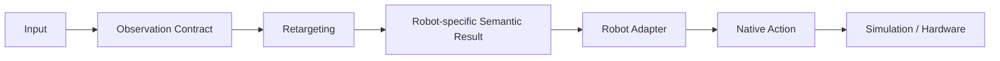

# 架构与模块边界

生产包是 `src/teleoperation`。完整工作流仅在 `applications` 中组装，CLI 使用静态命令注册并延迟导入应用 handler。



## 模块职责

| 模块 | 职责 | 边界 |
|---|---|---|
| contracts | 简单类型、声明、shape 与 validation | 仅标准库和 NumPy；不处理模型或文件工作流 |
| inputs | 获取和解析传感器原始结构 | 不变换坐标，不做 21→25、跟踪、窗口或推理 |
| retargeting | 坐标、拓扑、跟踪、时间算法、网络、FK、IK、安全控制 | 不运行设备，不选择任务，不依赖 learning |
| robots | 特定机器人的规格、手部映射、native action 编码 | 不读取人体 landmarks，不复制跨机器人手臂角 |
| simulation | 加载和执行机器人、任务、随机化、状态采集 | 不加载手部 checkpoint 或训练模块 |
| learning | Dataset 构建、loss、优化、epoch 计算 | 可用手部算法与数据读取；运行组装在 apps/training |
| data | schema、读写、序列化、事务、记录缓存 | 不调用对齐、滤波、推理、IK 或设备采集 |
| apps | 创建组件、按顺序调用、循环、同步、关闭资源 | 不实现坐标、IK、网络或关节映射公式 |
| tools | 绘图、显示、报告格式化 | 不独立组织业务流程 |

`inputs/replay` 只逐帧读取 NPY；`learning/dataset` 允许调用单帧处理与时间缓冲来构建样本。二者都不调用应用层。

## 手部链路

```text
MediaPipe / VisionPro / Replay
    → RawHandFrame
    → CanonicalHandProcessor.process_frame
    → CanonicalHandFrame
    → TemporalBuffer.append
    → HandWindow
    → PoseTransformerRetargeter.retarget
    → HandRetargetResult / L21HandAngles[18]
    → 显式去掉 placeholder
    → L21HandDOFs[17]
    → NativeHandAdapter
    → 原生机器人手部目标
```

`apps/hand_processing.py` 清楚展示采集、单帧处理与缓冲之间的连接。`CanonicalHandProcessor` 只持有 identity tracking 等单帧状态；`TemporalBuffer` 只持有已规范化帧。处理器与缓冲器分别重置。

MediaPipe palm-local 使用独立的 `MediaPipePalmLocalProcessor`：逐帧对齐，不启用 identity tracking，单侧失效立即清空该侧历史。hand 与 dual 复用 `apps/hand_processing.py` 的 `MediaPipePalmLocalPipeline`。原始 Unix 毫秒保留在 input；relative seconds 仍由 hand 摄像头应用用原先的 `round(time.time() - start, 3)` 计算。

hand 录制、实时与三机器人展示默认选择 world 米制模式；共用处理器的低层默认仍为 normalized，保持 dual 适配的既有行为。
world 和 normalized 的来源选择在处理器中明确完成，离线与实时调用同一个 `retargeting/hand/coordinates.align_mediapipe_hand()` 做 21→25、腕部相对化和掌面旋转。
world 对齐文件使用独立契约 `mediapipe_world_palm_local_to_l21_v1`；Dataset 直接缓冲这些已对齐米制点，关闭身份重分配和额外缩放。
模型加载与推理在 `contracts/coordinates.py` 的共同规则下验证来源、单位和尺度。原始 H5 的双空间存储在 `data/hand_recording.py`，来源声明与 world 字段读写在 `data/hand_h5.py`；应用层仅选择来源并组装流程。

NPY 保留关闭跟踪、缩放和缺失清空行为；H5 Dataset 保留跟踪配置、frame gap 重置、timeline 和 mask；Vision Pro 输入返回原始矩阵，坐标提取发生在 retargeting/topology，没有新样本时不更新缓冲。dual realtime 显式选择 legacy 或 palm-local；输入声明与预处理、checkpoint 必须精确匹配，未知空间拒绝处理。

`retargeting/hand/angles.py` 保留原有 float32 的 18→17 转换。原生回放先保留 float64 修复与平滑，再通过 `L21HandAngles.native_mapping_dofs()` 仅切掉占位维。原生映射仍依据原 18D 索引，取 17DOF 时显式使用索引减一。

## 双臂链路

```text
UpperBodyObservation
    → Calibration + ArmRetargeter
    → ArmTargetPose[xyz + xyzw]
    → ArmIK
    → ArmIKResult[q7, success, errors]
    → ArmSafetyController
```

上身关键点、末端 pose、IK 关节角不能以裸数组互相冒充。实时观测严格检查结构和有限值；离线无效观测保留上一目标。IK 失败保留 previous q 和 inf 误差；安全控制仍按原有成功标志与时间戳处理。

`apps/dual.py` 接收原始组合观测，手部与双臂分别处理，再组装 `Tron2AL21Command`。机器人层不解释人体 landmarks。

## 机器人动作与执行

TRON2A/L21 固定 `[LA7 | LH17 | RA7 | RH17]`，使用严格拼接或 `Tron2AL21ActionAdapter`。H1/GR1/G1 使用自己的原生关节语义目标和各自动作适配器，动作顺序仍由实际加载的 `action_joint_names` 表达。

`pack_partial_limb_vector()` 只返回 `PartialLimbVector`，没有自动 NumPy 转换。正式适配器拒绝 partial；`SimulationEnv.step` 在关节下发和物理步进之前拒绝 partial、错误维度与非有限动作。`None` 保留原行为。

## 文件与记录流程

```text
apps/hand_align
    → data/hand_h5 读取 schema 与声明
    → retargeting/hand/alignment 和 coordinates 计算
    → data/hand_h5 写入
    → data/transaction 关闭后 os.replace
```

事务使用同目录临时文件，失败清理自己的临时文件；输入与输出不能指向同一文件。历史 schema、metadata 与数据精度沿用已有实现。

```text
simulation/sensors.collect
    → SimulationSample
apps/simulation.EpisodeRecording
    → data/recorder 缓存与保存
```

仿真环境通过注入的 recording observer 发出原有采集时点事件；应用 observer 连接采集与持久化。`data/recorder` 不导入 PyBullet，也不查询机器人或相机。使用 `apps/simulation.create_environment()` 创建带录制的应用环境；直接构造 `SimulationEnv(record=True)` 需提供 recording observer。episode、evaluation、benchmark 循环位于 `apps/simulation.py`。

checkpoint 的文件序列化位于 `data/checkpoint`，state_dict 选择、严格加载和坐标 guard 位于 `retargeting/hand/checkpoint`。仿真只使用机器人和资源配置。

## 入口迁移

| 原入口 | 当前命令 |
|---|---|
| main.py | sim run |
| demo_teleop.py | sim demo-joints |
| main_train_twohand.py | hand train |
| main_offline_twohand.py | hand export |
| inspect_angle_h5.py | hand inspect |
| record_world_landmarks.py | hand record-world |
| scripts/align_h5_coordinates.py | hand align |
| main_offline_dual_teleop.py | dual export |
| main_realtime_dual_teleop.py | dual realtime |
| main_pybullet_dual_teleop.py | dual replay |
| scripts/replay_actions.py | replay actions |
| scripts/replay_hand_native.py | replay native-hand |
| scripts/replay_hand_angles.py | replay l21-hand |
| scripts/replay_hand_on_robot.py | replay mounted-hand |
| show_all.py / show_hand.py / scripts/show_hands_all.py | tools show-robots / show-hand / show-all-hands |
| test_import.py / test_camera.py | tools check-environment / check-camera |
| 其他 scripts 工具 | tools 文件名去扩展名、下划线转连字符 |

不保留旧路径 Python wrapper。静态架构测试检查直接导入、重导出后的传递依赖、受控动态导入和 partial 的生产调用位置。

## 废弃实现清理（2026-11-23）

当前入口以 CLI 注册表及实际应用组装为准。移除了未被当前入口、生产代码或测试引用的早期
TRON2/xArm7 演示流水线及其专用模拟 VR、手部接口，以及旧 VisionProWorkflow 和
realtime_support 模块。sim demo-joints 使用的 H1DemoJointCommand 继续保留；输入图像使用
contracts.observations.CameraFrame，episode 记录使用现行 data 与 applications/simulation 链路。

同步清除了未引用的旧窗口转换与选择函数、单帧 dex 包装、固定标定版 DexNativeRetargeter、
旧拇指平面角探针、训练/数据集辅助函数、脚本策略辅助函数，以及不再被线搜索调用的
paper IK 精确代价函数。现行线性化代价、数值求解、任务注册和正常控制入口继续使用原有实现。

learning/reporting 只保留指标格式化；learning/trainer 保留实际 epoch 计算与数据划分。
清除了两者复制残留的 TensorBoard 初始化、模型导入及无用配置，LOSS_NAMES 由 reporting
统一定义，trainer 保留同名导入供现有调用使用。

已完成的原生手对齐计划和 2026-10-11 旧集成记录由现行
[原生手说明](native-hand-control.md)、[米制采集](world-landmark-capture.md) 与
[README](../README.md) 覆盖，已从工作树删除；来源哈希与实际实验记录继续保留。
清理前检查点为 checkpoint-20261123-1236-remove-unused（提交 1dfc3ff0fabfbab5872643dc391420bf231a43f4）。

验证使用 D:/Anaconda/envs/teleoperation/python.exe、当前仓库 src 路径与 PYTHONUTF8=1，
临时目录和缓存均指向本仓库 outputs/tmp_unused_cleanup。

- 修改前后均执行 -B -m unittest discover -s tests：645 项，642 通过、3 跳过，退出码均为 0。
- 训练/坐标、手模型、NormalizedDex 与 CLI 针对性测试：23 项通过，退出码 0。
- 39 个注册 handler 导入、39 个命令帮助解析全部通过；283 个 Python 文件语法检查通过。
- 已删除模块的生产/测试导入为 0；已删除文档的剩余 Markdown 引用为 0；修改过的 Python 文件均可用 GBK 编码。
- 30 个内置任务显式注册成功；H1-2 原生动作回放使用 --dummy --steps 120 --no-render，退出码 0。
- 保留函数的 AST 均与检查点一致，唯一差异是移除了已删除 IK 诊断方法专用的 _dbg_left 初始化。
- git diff --check 通过。

快速 preflight 修改前后均退出 1，失败项相同：两份 GBK 扫描命中第三方源码/下载缓存、
C 盘既有 pip/HuggingFace 缓存，以及 runtime_environment.py 中 5 处现有 sys.path.insert。
检查前后的比较基线均为上述检查点，清理后的检查以 -Allow 显式列出本次用户授权修改的文件。
完整测试、针对性测试和自检日志保存在 outputs/tmp_unused_cleanup，本次清理未新增测试失败。
