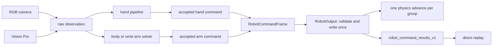

# 当前接口与后续处理边界

## 正式手部控制

RGB与Vision Pro经各自设备适配器进入`hand_palm_length_window3_v1`，两者均可选择SharedJointNNRetargeter或NormalizedDexRetargeter，然后共用JointCommandPipeline、原生执行和hand_joint_results_v1。入口是`hand control --source camera|visionpro --backend nn|dex`；VR快捷入口默认NN，NN/dex均转发共同应用。

设备与方法分别选择。VR来源如实记录，不套用相机原始预处理，也不改写权重元数据。契约、命令和输入统一时的验收记录见[统一手部输入](unified-hand-input.md)。

## 当前接口

|边界|实际内容|
|---|---|
|观测|CameraFrame、RawHandFrame、UpperBodyObservation、RawTeleopObservation、WristObservation|
|共同手窗口|hand_palm_length_window3_v1；canonical right米制25点→三帧→掌长中位数归一化|
|相机数值规范|camera_palm_length_window3_v1；训练、三机器人相机、TRON2A和部分导出仍使用|
|NN权重|每目标手型一份显式shared checkpoint；右手canonical输出，运行时适配左右侧；严格校验规格、关节顺序、数值规范和有效限位|
|算法结果|HandJointResult，目标手独立原生关节|
|执行命令|HandJointCommand；有效限位、滤波、限速、可选L21网格检查和耦合展开|
|手部结果|hand_joint_results_v1；分离raw与accepted command，回放校验规格、顺序和耦合|
|身体记录|smplerx_body_recording_h5_v1；保存RGB、模型包及来源时间|
|TRON2A|身体观测和原生L21命令组合成48D，每侧7臂+17手；统一入口通过 RobotCommandFrame/RobotOutput 提交|
|显式上游复现|hand vr --backend transhandr；内部原始18D、外部原生17D，诊断格式transhandr_vr_results_v2|

相机原始world、已对齐canonical world和Vision Pro矩阵记录仍由当前入口使用。相机采集保存观测并进行对齐；geometric.py仍供L21几何诊断使用。图像normalized坐标用于检测、预览及现存诊断，不等同于掌长归一化的无量纲后端窗口。

三机器人和新统一机器人入口用重复的`--hand-checkpoint MODEL PATH`指定各目标shared权重，dex无需操作者标定。TRON2A导出用`--hand-joints`读取原生命令；DualTeleoperator接受RawTeleopObservation和显式control_seconds。旧相机、VR手腕和TRON2A相机入口的最终执行都经过 RobotOutput；训练、导出和显式 TransHandR 保留各自原有格式。

## 保留并交由后续处理的部分

|剩余部分|当前消费者与边界|
|---|---|
|固定VR标定组件|hand dex-calibrate和devtools/dex_native_acceptance.py仍使用DexInputAdapter、DexCalibration、DexNativeRetargeter及相关辅助函数；正式NN/dex控制无需固定标定|
|相机pipeline与camera profile|MediaPipePalmLocalPipeline供三机器人和TRON2A预处理使用；camera profile还用于训练数据规范，不能直接删除|
|双臂legacy与normalized诊断分支|保留为数值诊断、旧结果格式和几何验收用途；整机执行边界已转发到统一输出|
|模型构造|hand_backend.build_hand_retargeter_from_specs统一实例化NN/dex；各入口保留来源、profile和权重选项校验|
|GBK扫描工具|devtools与诊断CLI各有入口，尚未合并|
|录制与动作验证|活跃H5格式用途不同；PartialLimbVector仍用于拒绝不完整机器人动作|
|环境工具与路径接口|preflight.ps1仍需维护；training_run_directory当前侧参数行为保留|

本次只清理无消费者代码和混合文件中的闲置部分；以上活跃分支、上游TransHandR、FK、KalmanSmoother、身体跟踪和原生执行/回放继续保留。具体范围和执行记录见[清理计划](superpowers/plans/2026-11-04-unused-code-cleanup.md)。

## VR 上游证据与边界适配

上游输入和原始网络输出保持不变。18→17转换仅在VR专用模型边界发生。
设备管理、源/目标手选择、命令处理和记录属于边界适配，不参与上游输入数值计算。
输入统一改动时，devtools/verify_vr_both.py对真实左分支与相邻注释右分支各验证10个连续窗口、scale=1.0和1.7。本次无调用代码清理未重新运行该数值比较。
左右输入张量最大差异0，原始模型输出最大差异0。右分支不是上游真实右手硬件验收。

源文件SHA-256：

| 文件 | SHA-256 |
|---|---|
| `D:\2026\code\TransHandR\TransHandR\main_visionpro_realtime.py` | `f6141c0aa57b88e98a641912edaa3791c81116dd49a61119b8c4b811c200ff8f` |
| `D:\2026\code\TransHandR\TransHandR\model\model_poseformer.py` | `9c80ba61d4465e63c7444347dbb4bb7f94e86fb976b884dc2b24c3155d94e8a3` |
| `D:\2026\code\TransHandR\TransHandR\dataset\robot\l21_right\linkerhand_l21_right.urdf` | `7387e62b5f0e126b2a4915fff6c2230ecfcfd00e93f2f499e963095a082cbf01` |
| `D:\2026\code\TransHandR\TransHandR\dataset\data_collect\data_collect_visionpro.py` | `deb77448a16059a54e13d2a459c4d0805965614fefb263cf1235ffdbc80d8610` |
| `D:\2026\code\teleoperation-system-retargeting\assets\robots\l21\left\linkerhand_l21_left.urdf` | `cb265e5cad0e41bd02d9c60fe461c3b83645a7584cce175152328cc34bafc57a` |
| `D:\2026\code\teleoperation-system-retargeting\assets\robots\l21\right\linkerhand_l21_right.urdf` | `4c7d580b7518cb58277020ca9a1d4ff69dafce694a76617795be4fab64b66ba7` |

输入统一时的本地数值报告：outputs/unified_hand/vr_upstream_equivalence.json。软件测试、数值等价与仿真探针不代替真实相机、头显或实体硬件验收。

## 2026-11-04无调用代码清理验收

|验证项|本次实际结果|
|---|---|
|主环境完整unittest|557项，554通过、3项因缺少dex_retargeting跳过；94.143秒|
|独立dex环境回归|test_normalized_dex、test_normalized_retargeters、test_unified_hand_inputs共16项全部通过，无跳过；覆盖主环境跳过的3项|
|CLI入口|26个注册handler均能定位函数，全部--help命令返回0|
|源码检查|269个Python文件AST解析成功，退役对象无残余代码引用|
|删除范围|10个源码模块及2份已被替代的计划文档；混合文件中的闲置成员按范围删除|
|文档|8份Markdown本地链接检查无断链；当前文档不再提供退役接口用法|
|算法保持|保留函数/类AST对比通过，shared预处理、dex求解器和TransHandR数值路径未改动|

相较清理前560项，减少的3项仅验证已退出的旧最新帧包装器、旧VR控制循环和旧独立录制格式；输出维数、规格身份、限位篡改、左右手转换等校验已保留或迁移到当前shared接口。组合录制、统一VR缺手/恢复、通用结果和严格回放测试继续执行。

各批检查点、提交和剩余消费者见[执行记录](superpowers/plans/2026-11-04-unused-code-cleanup.md#执行记录)。没有启动真实相机、头显或实体机器人；本次未重新生成上游数值等价报告，历史证据在上节单独标注。

## 统一机器人输出验收

2026-11-06修正相机无身体输入时的GUI闪动：统一求解入口按侧跳过无效身体观测，不再为保持命令执行IK。有效IK仍沿用原暖启动和数值求解，只在GUI连接下暂停渲染，恢复原q/qdot后再恢复渲染（包括异常路径）。DIRECT模式不切换渲染。该修改不改变手部NN/dex、命令滤波、物理步数或TransHandR上游数值。排查时的431帧验收记录中双臂有效观测均为0且接受命令恒定；修改前4帧缺失输入仍触发8次IK与384次临时关节重置。自动测试覆盖缺失双臂不求解、单侧缺失不阻塞另一侧、成功/异常恢复渲染及q/qdot。

新工作流的默认目标是单机器人；多机器人比较必须显式列出目标。仿真已验证四目标共享一个 PyBullet 连接时，同一提交只推进一次物理步；实体机器人发送后端、真实相机、真实 Vision Pro 和真实硬件仍需单独验收。

## 2026-11-06 代码归并

新一轮清理只删除无消费者片段并归并重复实现。整机回放以load_robot_recording和RobotRecording.iter_frames为正式读取入口，保留每帧receipt；退出未使用的iter_robot_commands和DualTeleoperator.produce_parts包装。KalmanSmoother继续提供在线reset/step；未使用的离线序列包装退出。MediaPipeCameraWorkflow.next_input公开输入接口仍保留。实施范围和逐批验证见[代码归并计划](superpowers/plans/2026-11-06-code-consolidation.md)。

## 当前代码归属

|使用场景|入口/应用|唯一维护实现或边界|
|---|---|---|
|统一机器人控制|robot control → applications/robot_control.py、robot_session.py|robot_commands组装；simulation/robot_output提交；robot_part_scene只加载所选目标/部位|
|整机命令回放|robot replay → robot_control.replay|data/robot_command_recording，直接提交命令与记录步数，不构造求解会话|
|独立手控制/导出/回放|hand control/export、replay hand-joints → applications/hand_control.py|共同手窗口、JointCommandPipeline、hand_joint_results_v1；保留L21 guard与独立场景|
|手模型构造|applications/hand_backend.py|build_hand_retargeter_from_specs；入口保留来源/profile/权重选项校验|
|手型/机器人标识|contracts/constants.py|HAND_MODELS、ROBOT_TARGETS；CLI help不引入数值库|
|手部对齐与检查|hand align/inspect|直接路由hand_align.run/hand_inspect.run，不再经hand.py转发|
|TRON2A相机/标定/导出|mediapipe_tron2a.py、dual.py、dual_export.py|保留安全标定和48D格式；通用工厂加载shared L21；未使用的produce_parts包装退出|
|显式上游复现|hand vr --backend transhandr|visionpro_hand/visionpro_processing/transhandr_vr，算法和来源证据独立保留|
|相机预览|applications/camera_preview.py、simulation/arm_preview.py|CameraPreview与ArmCameraPreview；后者是现用构造入口，删除无调用的旧build_preview包装|
|帧率与退出辅助|applications/realtime_support.py|统计和有界清理，各场景不再各复制|
|PyBullet初始化|simulation/urdf_loader.py|prepare_physics按client_id等待初始化；场景保留各自装载职责|
|旧相机诊断|simulation/realtime_teleop.py|保留HUD、诊断和调参，通过共同输出提交；目标必须显式选择|
|Windows诊断启动|devtools/run_realtime*.py|共用windows_runtime，保留三个IDE入口；重启原脚本，不切换成另一工作流|
|GBK检查|tools check-gbk-safe、devtools/check_gbk_safe.py|同一diagnostics扫描器，preflight只运行一次；跳过外部/输出树，不跳过自有robots源码|
|绘图等比例范围|tools/plotting.py|set_equal_axes显式保留调用方padding与zero_radius|
|NPY/NPZ观察记录读取|data/array_recording.py|只合并原有读取，不转换成整机或训练schema|
|任务仿真与基准|sim run → applications/benchmark.py、simulation.py|环境、任务注册、Sensors/Recorder仍有消费者；不等同真实遥操作任务成绩|

最终复核额外删除旧build_preview和PREVIEW_HINT_HANDS：仅被旧说明提及，没有运行时/测试/开发工具调用。CameraPreview及实际使用的build_arm_preview完整保留。本轮没有合并不同录制schema、可微FK与NumPy URDF几何，也没有修改TransHandR数值。历史清理/上游数值报告保留历史日期，不能当作本次重新执行的设备验收。

### 2026-11-06归并后的软件验证

|项目|实际结果|
|---|---|
|主环境完整unittest|606项，602通过、4项因dex依赖跳过；152.212秒|
|独立dex环境|33项全部通过，无跳过；覆盖新工厂、RGB/VR共用后端、机器人会话、比较、显示和机械臂稳定性|
|入口|28个注册handler均可定位，28条--help在无site-packages模式返回0|
|静态解析|180个源码、81个测试、28个Python开发工具、8个外部工作进程文件全部通过|
|数值保留核对|14个涉及数值处理的改动文件中，208个保留函数体AST与清理前一致|
|文档与检查|Markdown本地文件链接无断链，GBK严格扫描通过；PowerShell预检脚本语法通过|
|边界|未执行真实相机、头显或实体机器人；未重新生成历史上游数值等价报告；未推送|

本轮源文件净减少2个（182→180）；移除16个无消费者函数/方法并集中重复实现。逐批检查点、测试与保留原因见[归并执行记录](superpowers/plans/2026-11-06-code-consolidation.md#执行记录)。
