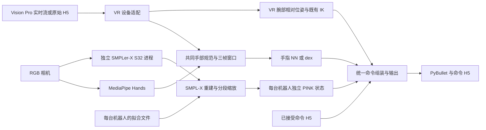

# 当前遥操作系统使用报告

日期：2026-11-13。运行时代码版本：`44908ee8353515074d4743ae2a36812e06264124`。
主项目：`D:/2026/code/teleoperation-system-retargeting`。

本报告说明已经实现的入口、数据流、操作方式和验收边界。配套操作代码为
[devtools/current_teleoperation.ps1](../devtools/current_teleoperation.ps1)。
脚本只组装并调用现有 CLI，不包含重定向算法，也没有修复本轮审查发现的问题。
当前正式控制出口是 PyBullet 仿真；以下命令没有连接实体机器人。

## 1. 系统总览与简要流程图



图中有两个需要明确的选择：

1. **手指算法**由 `--backend nn|dex` 选择；这个参数不会切换相机手臂算法。
2. **相机手臂**使用共同的 SMPL-X／分段缩放／PINK 实现；**VR 手臂**仍使用腕部相对位姿和既有 IK，没有接入这条 PINK 链路。

原始身体 H5 回到“重建与缩放”之前；已接受命令 H5 直接回到输出层。两种回放不能混用。

## 2. 当前支持范围与使用条件

| 机器人 ID | 对应手型 ID | 每侧手指独立／展开关节数 | 相机手臂 | VR 手臂 | 手指 NN／dex |
|---|---|---:|---|---|---|
| `h1_2` | `h1_2` | 6／12 | 共同 PINK | 既有腕部 IK | 支持 |
| `gr1_t2` | `gr1_t2` | 6／11 | 共同 PINK | 既有腕部 IK | 支持 |
| `g1` | `g1` | 7／7 | 共同 PINK | 既有腕部 IK | 支持 |
| `tron2a_l21` | `l21` | 17／17 | 共同 PINK | 不支持；可只控制手指 | 支持 |

相机手臂使用同一套代码，每台机器人分别持有拟合参数、PINK 配置和已提交关节状态。
默认规格均为每臂 7 关节，但求解类按规格中的关节名称工作，不在求解器内部写死 7 维。
“共同实现”目前覆盖表内四种规格，新增机器人仍须补齐 URDF、关节、末端、标志点和参考姿态等声明。

`--parts arms|hands|both` 选择控制部位，`--side left|right|both` 选择侧别。
`--robot` 选择一台，`--robots` 选择至少两台且不得重复。
多机器人接收同一份人体观测，各自生成目标和求解；没有把机器人 A 的关节角直接复制给 B。

当前相机坐标约定要求相机竖直、正对操作者；任意倾斜或侧向机位尚需独立外参标定。
生产相机链路固定共享躯干和未启用手臂的关节。头部、躯干和手指不参与 PINK 求解。

## 3. 环境与本机资源

以下资源已在编写本报告时检查路径存在。存在不等于完成真人设备验收。

| 资源 | 当前本机路径／要求 |
|---|---|
| 主控制解释器 | `.venv/dex-native/Scripts/python.exe`；当前数值验证使用此解释器 |
| SMPLer-X 独立解释器 | `.venv/smplerx-worker/Scripts/python.exe` |
| SMPLer-X 源码 | `.venv/smplerx-assets/SMPLer-X` |
| S32 权重 | `.venv/smplerx-assets/smpler_x_s32.pth.tar` |
| MediaPipe Hands | `datasets/hand_landmarker.task` |
| 许可人体模型 | `datasets/smpl_models`，相机拟合和运行重建使用 SMPL-X |
| 官方 `smplx` 包本地目录 | `outputs/unified-arm-runtime` |
| 已配置的 PINK／QP 依赖目录 | `outputs/acceptance/teleopbench-gr1-20261111/dependencies` |
| 四机器人已生成拟合 | `outputs/acceptance/unified-smpl-pink/fittings-v2/<robot_id>.json` |
| 新坐标约定下的合成身体录像 | `outputs/acceptance/review-fixes-pipeline/synthetic-raw-real-smpl.h5` |
| 本机 VR 原始样本之一 | `datasets/raw/visionpro_hand_arm_20261012_215137_live.h5` |

控制解释器需要数值计算、PyBullet、手部算法依赖及所选输入依赖。相机身体估计只在独立 worker 中加载
SMPLer-X／CUDA 网络；主进程加载的是较轻的人体几何重建模型。不要用 worker 的旧网络环境替换控制环境。
手指 NN 另需与目标手型、规格 hash、关节顺序和输入 profile 匹配的一份 shared checkpoint。
dex 不需要手指 NN 权重。实时 VR 另需可运行的 `avp_stream` 和头显流；原始 VR H5 回放不需要在线头显。

`requirements-arm.txt` 固定可选手臂包版本：`smplx 0.1.28`、`pin-pink 4.4.0`、
`qpsolvers 4.13.0`、`quadprog 0.1.13` 和 `loop-rate-limiters 1.2.0`。
现有目录是本机配置，迁移到另一台机器时需要重新准备依赖和许可资产，不能仅复制报告中的目录名。
脚本会为本次进程配置上述源码和依赖搜索路径，结束后恢复原来的 `PYTHONPATH`。

## 4. 可直接使用的操作代码

配套脚本的默认行为是检查路径并列出手型；不会默认打开相机。
`-DryRun` 仅输出解释器、工作目录和 CLI 参数 JSON，不创建输出目录，也不打开设备。
运行控制时默认 300 个控制帧，`-Frames 0` 持续运行至关闭窗口或中断；身体录制必须指定正数帧数。
`CommandReplay` 按文件中的命令帧数回放，`Fit` 固定执行示例中的 300 次优化；这两种模式不使用 `-Frames`。
每次真实操作使用新的输出目录，已有输出目录拒绝复用，以免把多次实验混在一起。

### 4.1 检查并先运行不依赖设备的身体回放

```powershell
Set-Location D:\2026\code\teleoperation-system-retargeting
$run = '.\devtools\current_teleoperation.ps1'
$repo = (Get-Location).Path
$stamp = Get-Date -Format 'yyyyMMdd_HHmmss_fff'
$fits = Join-Path $repo 'outputs/acceptance/unified-smpl-pink/fittings-v2'
$body = Join-Path $repo 'outputs/acceptance/review-fixes-pipeline/synthetic-raw-real-smpl.h5'
$replayOutput = Join-Path $repo "outputs/manual/body_replay_$stamp"

& $run -Mode Check
& $run -Mode BodyReplay -Robots g1 -InputPath $body -FittingDirectory $fits `
  -Frames 0 -Headless -OutputDirectory $replayOutput -DryRun

# 实际运行：重建人体、缩放、PINK、PyBullet、保存已接受命令。
& $run -Mode BodyReplay -Robots g1 -InputPath $body -FittingDirectory $fits `
  -Frames 0 -Headless -OutputDirectory $replayOutput

# 从上一条命令生成的关节命令回放；不再次推理、重建或求解。
& $run -Mode CommandReplay -Robots g1 `
  -InputPath (Join-Path $replayOutput 'commands.h5') -Headless
```

这里的 `$body` 是合成姿态的软件测试样本，不能作为真人遥操作质量证明。
需要观察窗口时去掉 `-Headless`。控制输出包括 `commands.h5` 和 `control-report.json`；
命令回放输出 `replay-report.json`。启动时终端会打印本次 `Run output` 目录。

### 4.2 生成自己的四机器人拟合文件

已有拟合可以直接使用；更换机器人 URDF、人体模型或 β 维度后应重新拟合。

```powershell
$fitOutput = Join-Path $repo "outputs/manual/fit_$stamp"
& $run -Mode Fit -Robots h1_2,gr1_t2,g1,tron2a_l21 -OutputDirectory $fitOutput
$myFits = Join-Path $fitOutput 'fittings'
```

输出 `fittings/h1_2.json` 等四份文件，以及 `fit-report.json`。
脚本示例使用中性 SMPL-X、20 维 β、CPU、300 步优化。20 维是这份操作示例的选择，
不是算法内部常量。直接使用 `arm fit --num-betas N` 可选择资产支持的其他维度，但拟合与重建必须一致。
首次拟合会加载许可模型并完成优化，耗时比简单命令回放长。

### 4.3 RGB 实时控制手臂、手指和两者

以下为当前入口的使用方法；第 7 节的三项未修复问题同样适用，不能据此宣称动态运行已通过验收。

```powershell
# G1 双臂，使用已经核对的拟合。去掉 -Headless 时打开仿真窗口。
& $run -Mode CameraArms -Robots g1 -FittingDirectory $fits -Frames 300

# G1 双臂加双手；手指使用无权重 dex，手臂始终是 PINK。
& $run -Mode CameraBoth -Robots g1 -Backend dex -FittingDirectory $fits -Frames 300

# 只控制手指；不启动 SMPLer-X，不需要手臂拟合。
& $run -Mode CameraHands -Robots g1 -Backend dex -Frames 300

# 四机器人同时控制双臂。simplified 只改变 TRON2A 几何，其他三台保持原网格。
& $run -Mode CameraArms -Robots h1_2,gr1_t2,g1,tron2a_l21 `
  -FittingDirectory $fits -Geometry simplified -ControlHz 100 -Frames 300 -Headless

# 手指 NN：必须把示例路径替换成已训练且匹配 G1 的 shared 权重。
$weights = @{g1='D:/path/to/g1/shared/model_best.pth'}
& $run -Mode CameraBoth -Robots g1 -Backend nn -HandCheckpoints $weights `
  -FittingDirectory $fits -Frames 300
```

多机器人 NN 每个手型各给一份 checkpoint。TRON2A 的键是 `l21`，例如
`@{h1_2='...';gr1_t2='...';g1='...';l21='...'}`；只有手臂时不要传手指权重。
只开一侧用 `-Side left` 或 `-Side right`。切换摄像头用 `-CameraIndex 1`。
`-ControlHz` 必须在 50～240 范围内，表示请求的控制频率，不能代表机器已经达到该频率。
目前默认 TRON2A 的完整网格资源不齐，因此示例显式选择简化几何。

不用脚本、直接调用当前 CLI 的等价 G1 双臂例子如下：

```powershell
$python = Join-Path $repo '.venv/dex-native/Scripts/python.exe'
$env:PYTHONPATH = @(
  (Join-Path $repo 'src'),
  (Join-Path $repo 'outputs/unified-arm-runtime'),
  (Join-Path $repo 'outputs/acceptance/teleopbench-gr1-20261111/dependencies')
) -join [IO.Path]::PathSeparator

& $python -m teleoperation robot control --robot g1 --source camera `
  --parts arms --side both --backend dex --arm-fitting-dir $fits `
  --model-asset-path (Join-Path $repo 'datasets/hand_landmarker.task') `
  --smplerx-worker-python (Join-Path $repo '.venv/smplerx-worker/Scripts/python.exe') `
  --smplerx-root (Join-Path $repo '.venv/smplerx-assets/SMPLer-X') `
  --smplerx-checkpoint (Join-Path $repo '.venv/smplerx-assets/smpler_x_s32.pth.tar') `
  --smplx-model-dir (Join-Path $repo 'datasets/smpl_models') `
  --camera-index 0 --control-hz 100 --target-max-age 0.3 --frames 300
```

### 4.4 录制身体原始输入，再用相同算法回放

```powershell
$captureOutput = Join-Path $repo "outputs/manual/body_capture_$stamp"
& $run -Mode RecordBody -Frames 180 -CameraIndex 0 -OutputDirectory $captureOutput

# 对实际录下的同一段观测，同时重定向到四台机器人。
& $run -Mode BodyReplay -Robots h1_2,gr1_t2,g1,tron2a_l21 `
  -InputPath (Join-Path $captureOutput 'body.h5') -FittingDirectory $fits `
  -BodyParts arms -Geometry simplified -Frames 0 -Headless
```

录制阶段启动相机、MediaPipe 和 SMPLer-X，不做机器人重定向。
文件保留 RGB、手部观测、身体原始姿态参数、源时间和有效性。
`-Headless` 在录制模式中等价于关闭相机预览；在控制模式中等价于关闭仿真 GUI。
录制 180 个相机样本不代表 180 个有效身体结果，也不代表固定 6 秒；实际处理速度取决于负载。

### 4.5 Vision Pro：先离线，再选择实时输入

```powershell
$vr = Join-Path $repo 'datasets/raw/visionpro_hand_arm_20261012_215137_live.h5'

# 严格只控制 G1 手指。
& $run -Mode VisionProHands -Robots g1 -InputPath $vr -Backend dex -Frames 120 -Headless

# 同时启用腕部相对运动和手指；不使用相机、SMPL-X 拟合或 PINK。
& $run -Mode VisionProBoth -Robots g1 -InputPath $vr -Backend dex -Frames 120 -Headless

# 实时：把头显地址替换为实际地址。InputPath 和 VisionProIp 必须二选一。
& $run -Mode VisionProBoth -Robots g1 -VisionProIp 'HEADSET_ADDRESS' `
  -Backend dex -Frames 0
```

TRON2A 可使用 `VisionProHands`，但 `VisionProBoth` 会拒绝其 VR 手臂。
`hand control --source visionpro --hand-model g1` 等旧独立手入口，在原装机器人场景中还会启用腕部跟随；
如需严格“只动手指”，使用上面的 `robot control --parts hands` 封装模式。

### 4.6 手部数据、训练、导出与结果回放

这一流程用于准备 NN 权重；它不训练 SMPLer-X，也不训练机械臂 PINK。
以下接续 4.3 节设置的 `$python` 和环境；所有示例输出必须为新路径。

```powershell
$rawHand = Join-Path $repo "datasets/raw/hand_$stamp.h5"
$alignedHand = Join-Path $repo "datasets/raw/aligned_hand_$stamp.h5"
$modelRoot = Join-Path $repo 'outputs/hand_retargeting/models'
$runName = "manual_$stamp"
$handResults = Join-Path $repo "outputs/hand_retargeting/g1_results_$stamp.h5"

& $python -m teleoperation hand record --landmark-space world --hand-side both `
  --model-asset-path (Join-Path $repo 'datasets/hand_landmarker.task') `
  --frames 900 --output $rawHand --aligned-output $alignedHand

& $python -m teleoperation hand train --input $alignedHand --hand-model g1 `
  --run-name $runName --checkpoint-root $modelRoot --epochs 100 --device auto

$checkpoint = Join-Path $modelRoot "g1/shared/nn/camera_palm_length_window3_v1/$runName/model_best.pth"
& $python -m teleoperation hand export --input $alignedHand --hand-model g1 `
  --backend nn --hand both --checkpoint $checkpoint --output $handResults

& $python -m teleoperation hand inspect --angle-h5 $handResults
& $python -m teleoperation replay hand-joints --input $handResults --hand-model g1 --hand both
```

`hand record` 自动生成对齐文件。若已有未对齐的米制手部 H5，可用 `hand align` 单独处理；
不要重复对齐已对齐文件。训练使用目标手可微模型相关损失，不要求逐帧机器人关节角标签；
短跑通训练不能证明跨操作者精度。每个目标手型输出一份左右共享的 canonical-right NN。

## 5. 各条链路的详细说明

### A. 机器人形态拟合与缩放参数链路：一次准备，多次复用

入口为 `applications/arm_fit.py`，几何声明在 `robots/arm_spec.py`。
首先读取目标 URDF 和双臂参考姿态，得到骨盆、肩、肘、腕等机器人标志点。
人体模型在原生零姿态下重建；通过人体与机器人的躯干方向建立一个 proper rotation。
优化 β，使人体参考关键点靠近机器人的参考点，然后根据相应连杆长度计算分段缩放因子。

人形机器人使用骨盆锚点，拟合骨盆、双肩、双腕；TRON2A 使用肩中心锚点，拟合相对肩中心的双肩和双腕，
不会凭空制造骨盆段。当前默认规格没有声明头部标志点，因此默认拟合没有头部损失。
肘用于建立连杆长度，不是额外的默认形状拟合目标。

每份 JSON 保存模型身份、β 维度与数值、机器人规格 hash、人体到机器人旋转、锚点、
缩放因子、腕参考旋转偏移和拟合误差。运行加载时校验身份，不能随意截断或补零 β。
目前相机链路只接受 SMPL-X；通用 `BodyModel` 支持其他家族，不代表相机姿态转换已经适配它们。

输入是模型资产和机器人规格；输出是每台机器人的拟合 JSON，不是手指 NN 权重。
形状优化没有人体生理先验约束，β 较大时应结合误差和姿态观察检查，不能只凭拟合 RMS 小就认定重定向质量合格。

### B. RGB 手臂链路：观测到机器人目标

入口为 `applications/camera_teleop_source.py` 和 `applications/unified_camera_control.py`。
一次相机采集的 RGB 同时用于 MediaPipe Hands 和 SMPLer-X，避免两个相机读取位置不一致。
SMPLer-X 在独立进程中运行，返回根／躯干／手部姿态、原始形状及辅助关节几何。
`BodyTracker` 检查各侧有效性、跳变和恢复；只有真正的新结果才更新身体输入身份。

`ArmPipeline.ingest` 对新有效结果进行一次重建。根旋转先经 `diag(1,-1,-1)` 从正对相机的约定转换到原生拟合轴；
随后用每台机器人已拟合的 β 重建关节。重建结果为 55 个原生运动学关节的位置和全局旋转，
位置以骨盆为根，单位为米；它不是 MediaPipe 图像归一化坐标。
多台机器人的不同 β 在同一次新观测更新中分别重建，控制步不会重复运行网络或重复重建同一观测。

之后减去配置的人体锚点，应用人体到机器人旋转，按骨盆／肩中心—肩—肘—腕逐段缩放，
再加回机器人锚点，生成机器人根坐标中的腕位置。腕朝向由同一重建的全局旋转加参考旋转偏移得到。
当前 PINK 的直接目标是腕位置和朝向。缩放过程使用了肘点，不表示机器人肘位置已经受到直接跟踪约束。

### C. RGB 手指链路：两种算法，共同输入与命令策略

主要模块为 `applications/hand_processing.py`、`applications/hand_backend.py` 和
`retargeting/hand/joint_commands.py`。
MediaPipe 提供 21 点 world 米制关键点；适配器恢复掌部基底、左右语义和 canonical-right 坐标，
扩展为 25 点。图像 normalized 点用于图像显示和记录，不可直接当成米制几何输入。

每侧分别积累 3 个有效观测，形成 `(3,25,3)` 窗口，用三帧掌长中位数归一化为无量纲输入。
预热、缺失和恢复按侧处理；恢复需要新的有效窗口。换设备或输入契约错误会清理历史。

- **NN**：加载目标手型的 shared 权重，预测 canonical-right 的独立关节角，再转换成实际侧的语义。
  loader 检查手型、规格、关节顺序和支持的 profile，不能直接拿旧 18D TransHandR 权重代替。
- **dex**：使用目标手运动学模型，通过归一化手部几何／向量目标优化独立关节，不需要手指 NN 权重或固定掌长标定。

共同结果是 `HandJointResult`。之后执行低通／Kalman／无滤波、角度限制、速度策略和 URDF 耦合展开，
形成实际机器人关节命令。`--joint-max-velocity` 仅针对手指命令；PINK 手臂读取的是 URDF 速度限位。
当前等待后的手部速度约束存在第 7 节 R2，不能把参数值直接当成已满足的实际输出保证。

### D. Vision Pro 手指链路：设备适配不同，后端相同

`inputs/visionpro.py` 读取实时 SDK 或 `source=visionpro` 的原始矩阵 H5。
每侧手指输入为 25 个 `4×4` 变换，腕变换单独保留。设备适配器提取平移、恢复轴和拓扑、建立掌基，
进入与 RGB 相同的米制手部契约和掌长三帧窗口，再使用同一个 NN 或 dex 与命令策略。

不能把 SDK 矩阵直接改标签当成 MediaPipe world21，也不能把 VR 腕姿态通过手指左右归一化处理。
实时源会处理缓存包和追踪状态；离线源保留原记录时间，并检查帧数、矩阵形状和源声明。
切换输入设备不代表已经验证同一 NN 在不同设备噪声下的精度；这里只保证接口和数值规范一致。

### E. Vision Pro 手臂链路：相对腕部位姿

主要模块为 `simulation/wrist_control.py`、`retargeting/arm/wrist_orientation.py`、
`simulation/arm_scene_driver.py` 和 `simulation/arm_ik.py`。
它只消费真实腕位置和朝向，没有由腕位置编造肩、肘观测，也不需要 SMPL-X 拟合文件。

先收集每侧稳定的中性腕姿态。当前默认腕跟踪器需要 10 个新的有效样本；重复 SDK 包不计入样本数。
记录人体初始腕位姿和机器人初始末端位姿，之后将人体相对运动映射到机器人基座。
旋转使用 `C R(t) R(0)^T C^T`，再作用于机器人初始末端朝向；SDK Z-up 的映射与相机坐标转换分开。
当前跟踪器还包含旋转平滑、跳变处理、20 cm 相对位移范围和位移／旋转变化率限制。

目标交给既有 `ArmSceneDriver`／`PyBulletArmIK`，再进入整机命令输出。
该链路与相机的形态缩放 PINK 链路并未统一算法，当前不支持 TRON2A VR 手臂。
单独 `robot control --parts hands` 可明确关闭腕部驱动。

### F. 连续控制、每机器人求解状态与统一输出

相机含手臂时，`ObservationPump` 把采集与控制分离，保留待消费的新身体结果和最新手部观测。
视觉样本到达时更新人体目标；控制循环反复使用最近有效目标推进 PINK。
源时间和控制相对时间分别保存，重复使用同一个目标不会刷新其原有效期。
默认目标最大年龄是 0.3 秒，PINK 单次积分不超过 20 ms，CLI 控制频率范围为 50～240 Hz。

每台机器人各有一个 `PinkArmIK`，同一机器人同时求解已启用的两侧任务，避免共享关节被左右两次求解覆盖。
当前生产配置禁止共享躯干自由度。未启用／无效的一侧由关节保持约束锁定。
任务由腕位置、腕朝向和姿态正则组成，配置含权重、增益和阻尼；肘任务显式不支持。

手臂先生成候选状态；命令组装器生成完整四部位或已选部位命令；输出层先验证选定机器人的全部命令，
再调用后端并对共享物理世界推进一次。成功收到输出回执后提交 PINK 候选及命令组装状态。
求解异常保持上一条合法命令。不可达目标可能留下跟踪残差，不能把“QP 返回有限值”当成目标已达到。

写入或物理推进异常可能已经部分执行，输出会记录实际已知状态并停止，不伪装成能够原子回滚。
上述提交机制描述的是手臂候选与命令组装状态；手部滤波器仍在准备命令时更新，不能理解成整个系统所有状态都已实现事务。
第 7 节 R1、R3 表明实时调度和提交前有效期检查仍有缺口。

### G. 两种回放链路

| 回放类型 | 输入 | 是否重新运行网络 | 是否重建／求解 | 适用目的 |
|---|---|---|---|---|
| 身体原始观测回放 | `smplerx_body_recording_h5_v1` | 否 | 是，复用共同重建／缩放／PINK；手指按所选后端处理 | 对同一观测比较机器人、算法配置及重定向行为 |
| 整机已接受命令回放 | `robot_command_results_v2`，也可读受支持的 v1 | 否 | 否 | 重放已经保存的执行命令和物理步数 |
| 独立手关节结果回放 | `hand_joint_results_v1` | 否 | 不重新求手指解或重复滤波 | 检查手指训练／导出的结果 |

身体录像的新无效结果会撤销旧目标；`None` 代表没有新结果。旧包的恢复受记录的有效性和身份约束，
缺少原始姿态的旧派生点录像不能用于新的手臂重建链路。
命令回放校验机器人规格、URDF、关节顺序、限位、耦合和完整回执；不借用当前 NN、人体模型或 PINK 状态重算。
命令录制在正常关闭后发布；失败或中断保留带失败标记的 pending 文件，不能当作完整成功录像。

### H. 离线手部数据到 NN 的准备链路

`hand record` 保存人体手部观测，`hand align` 建立声明的 canonical 米制规范，
`hand train` 用目标手模型建立训练目标并输出 shared checkpoint。
`hand export` 按原始时间线生成独立解、耦合展开命令、有效性和诊断；预热或缺手帧不会被悄悄删掉。
这些步骤生成的是手指模型与结果，不改变机器人手臂形态拟合、SMPLer-X 网络或 PINK 任务。

### I. 旧入口与上游复现的边界

日常相机控制优先使用 `robot control`；`dual camera` 和部分旧相机入口只是参数转接，
仍须提供新的拟合目录。旧 `dual realtime`／`dual export` 相机适配入口已明确拒绝，不应继续照 README 历史命令运行。
历史相机基线在 `devtools/legacy_*`，用于诊断和比较，不是另一条默认生产算法。

`hand vr --backend transhandr` 保留上游复现，其固定缩放、三帧处理、旧权重布局和诊断格式独立。
它不能替代当前四手型 shared NN，也不属于相机 SMPL-X／PINK 重定向。
其精确命令和历史数值等价证据见 [统一手部输入说明](unified-hand-input.md)。
`sim run` 的任务演示／基准同样不是实时人体输入验收，不能把任务演示分数作为当前重定向质量证明。

## 6. 文件、时间与输出的使用约定

| 内容 | 单位／身份 | 使用时的关键区别 |
|---|---|---|
| RGB 图像关键点 | 图像 normalized | 用于图像显示和记录，不是机器人米制目标 |
| 人体／机器人三维位置 | m | 必须说明人体原生、相机或机器人根坐标 |
| 手部三帧网络／dex 输入 | 掌长归一化，无量纲 | canonical right；不是原始 VR 矩阵 |
| 机器人关节角 | rad | 按目标规格的名称和顺序，含必要耦合展开 |
| 相机身体源时间 | monotonic seconds | 原始采集时刻，不能用处理完成时刻替换 |
| 控制命令时间 | control relative seconds | 与源时间通过年龄／有效期转换关联 |
| 拟合 JSON | 模型 hash、β、规格 hash | 与目标机器人和重建模型绑定 |

`robot control --record-results` 记录已输出命令，不等于录制相机 RGB／人体原始输入。
要留存可重新重定向的身体数据，应先使用 `hand record-world`。
`hand control --record-results` 是独立手结果格式，应使用 `replay hand-joints`，不能交给 `robot replay`。
输出文件独占创建；重复实验使用新目录，不覆盖已有实验。

## 7. 本轮审查结果与当前未完成项

本报告没有修复以下三个已复现问题；它们仍存在于运行时 `44908ee`。

| 编号 | 级别与位置 | 已确认的行为 | 对使用的影响 |
|---|---|---|---|
| R1 | P1，`unified_camera_control.py:197` | 卡顿后继续追赶启动时的时间表，恢复阶段可每 1 ms 执行一次、却按 10 ms 积分 | 不能认为“设置 100 Hz 并限制单步 dt”就保证实际命令推进速度；实时动态控制仍需修复调度 |
| R2 | P2，`robot_session.py:59` | 手部等待步没有更新输出时间；1 rad/s 配置下复现了 4 rad/s 的相邻输出变化 | 保留滤波历史的修复尚未保住实际输出速度约束 |
| R3 | P2，`unified_camera_control.py:181` | 290 ms 的有效样本经 50 ms 重建后，以 340 ms 年龄继续提交为 tracking | 当前 300 ms 有效期未在实际提交前重新检查 |

复现代码位于本机工作区：

- `D:/2026/code/PyCharmMiscProject/outputs/review-unified-smpl/reproduce_live_deadline_debt.py`
- `D:/2026/code/PyCharmMiscProject/outputs/review-unified-smpl/reproduce_hand_wait_velocity.py`
- `D:/2026/code/PyCharmMiscProject/outputs/review-unified-smpl/reproduce_expiry_during_reconstruction.py`

这些属于确定的实现缺陷；另有当前尚未完成的验收：任意机位外参、真人相机／头显动态连续质量、
实体机器人运动和四机器人 CPU 100 Hz 性能。TRON2A 当前完整网格缺失，需要显式简化代理。
默认头部标志点／头部任务和肘直接跟踪任务也未启用，因此不能称为论文全部约束的完整复现。

已有软件证据：最近一轮完整测试执行 690 项，`OK (skipped=2)`；本轮只读复审另外运行 22 项相关测试通过，
并独立复现 R1～R3。现有测试通过不覆盖这三项缺陷。
新相机坐标约定下的四机器人集成测试，每次 12 个身体样本、38 个控制帧，单独运行与一起运行命令差值为 0。
对应四机器人 CPU 测试仍错过全部 10 ms 目标周期；它是在其他测试同时运行时测量，不能视为独立性能基准。

主要证据文件：

- [完整测试日志](../outputs/review-fixes-full-tests-final.log)
- [四机器人链路报告](../outputs/acceptance/review-fixes-pipeline/pipeline-report.json)
- [形态拟合与 PINK 实现及历史验收](unified-smpl-pink.md)

## 8. 主要代码阅读入口

| 要了解的内容 | 文件 |
|---|---|
| CLI 选择与前置检查 | `src/teleoperation/cli/robot_options.py`、`applications/robot_control.py` |
| 相机采集与身体结果有效性 | `applications/camera_teleop_source.py`、`inputs/body_tracking.py` |
| 人体模型、姿态与坐标转换 | `retargeting/arm/body_model.py` |
| 形态拟合、分段缩放 | `applications/arm_fit.py`、`retargeting/arm/shape_fitting.py`、`segment_scaling.py` |
| 机器人几何／任务声明 | `robots/arm_spec.py`、`robots/control_spec.py` |
| 相机目标与每机器人求解状态 | `applications/arm_pipeline.py`、`retargeting/arm/pink_ik.py` |
| 相机高频循环 | `applications/unified_camera_control.py` |
| 共同手部预处理与算法选择 | `applications/hand_processing.py`、`applications/hand_backend.py` |
| 手指命令处理 | `retargeting/hand/joint_commands.py` |
| VR 原始输入与相对腕控制 | `inputs/visionpro.py`、`simulation/wrist_control.py`、`retargeting/arm/wrist_orientation.py` |
| 命令组装、输出、后端 | `applications/robot_session.py`、`robot_commands.py`、`simulation/robot_output.py`、`robot_backends.py` |
| 原始身体／关节命令文件 | `data/body_recording.py`、`data/robot_command_recording.py`、`data/hand_joint_recording.py` |

上表除首次给出的 `src/teleoperation/` 前缀外，路径均相对于该 Python 包。
真人设备启动命令仅核对入口与参数，不视作设备实测。

## 9. 本次报告与操作代码的验证记录

本次只新增文档与 CLI 操作包装脚本，没有修改重定向、调度或输出运行时代码。
因此没有重跑完整 690 项套件；第 7 节数字仍是相应代码版本的历史测试证据。
此次实际完成的检查为：

| 检查 | 结果 |
|---|---|
| PowerShell 语法 | 操作脚本和报告内 7 个 PowerShell 代码块均通过解析 |
| CLI 参数 | 13 组操作参数经当前 `build_parser` 解析通过，覆盖全部 10 种脚本模式 |
| 路径与错误输入 | 相对路径／含空格路径检查通过；重复机器人、身体录制 0 帧、VR 输入冲突和 TRON2A VR 手臂 4 类错误被拒绝 |
| G1 身体回放 | 12 个合成身体样本，12 次重建，输出 38 个控制帧及命令 H5 |
| G1 命令回放 | 上述 38 帧已接受命令直接回放，推进 91 个物理步 |
| G1 VR 只控制手指 | 对本机已有真实 VR 矩阵录像运行 12 帧，报告 `arm_mode=off` |
| G1 VR 手臂加手指 | 同一原始录像运行 12 帧，报告 `arm_mode=wrist` |

上述试跑均为无 GUI 的 PyBullet 离线运行，没有打开真人摄像头或在线头显。
NN 命令中的权重路径仍为需要用户替换的示例，没有把不存在的权重作为成功验收依据。
详细 JSON、命令参数和日志保存在
[outputs/usage-report-validation/validation.json](../outputs/usage-report-validation/validation.json)
及同目录中。该目录是本机验收产物，不属于随源码分发的许可资源。
