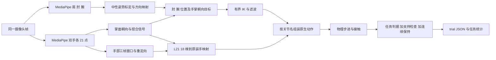

# 当前 30 项操作实验：原理、流程与实施代码

核对日期：2026-11-23。分析基线：`e0eb35ff41e287782bef19512cda7c469d45e44c`。
修改前注释标签：`checkpoint-20261123-1151-experiment-walkthrough`。

本说明依据当前源码；截图、旧文档和模块顶部注释中的历史结论不自动代表当前实现。
逐项操作与精确阈值见 [30 项任务判据](experiment-task-criteria.md)。此次只新增说明文档，不改变控制和计分行为。

**入口范围澄清（2026-11-23）**：当前仓库的统一手部和机器人控制已经支持原生 `nn/dex`，
不要求经过 L21 18 维中间表示。本文后面的任务运行、抓取辅助、单侧控制和计分说明，
专门针对 `devtools/task_eval.py`；其手部默认使用统一原生 Dex 工厂；
显式 `auto/geometric/checkpoint` 才使用旧手部实现。不能将这个任务工具的限制推广到统一控制入口。

| 入口 | 手部后端选择 | 手部输出路径 |
|---|---|---|
| `python -m teleoperation robot control` | `--backend dex` 或 `--backend nn`，默认 `dex` | 目标手型原生关节结果，再经过命令处理与执行；支持 `--side both` |
| `python -m teleoperation hand control` | 显式 `--backend dex` 或 `--backend nn` | 所选手型的原生关节结果；支持 `--hand both` |
| `python devtools/task_eval.py --policy camera` | `--hand-backend dex` 默认；旧后端显式选择 | 默认原生手关节；旧后端经 L21 映射；当前每次驱动一侧 |

定义见 [robot 参数](../src/teleoperation/cli/robot_options.py#L22)、
[hand 参数](../src/teleoperation/cli/hand_joint_options.py#L11)、
[原生后端工厂](../src/teleoperation/applications/hand_backend.py#L28)、
[任务工具参数](../devtools/task_eval.py#L3345)。
统一控制工作流见 [原生手部与统一控制指南](native-hand-control.md)。

## 1. 实验实际测什么

实验将人的手臂与手指动作转换成机器人关节目标，在 PyBullet 中与任务物体交互，
再用物体位置、朝向及部分接触条件判断是否成功。任务按注册表分成 5 / 11 / 9 / 5 项，
合计 30 项。支持 `h1_2`、`gr1_t2`、`g1` 三种机器人。

需要分别解释三种结果：

| 结果 | 实际证据 | 能支持的结论 |
|---|---|---|
| 场景可评测 | `--verify` 的稳定性、初始不成功、oracle 可触发、几何可达检查 | 具备开展该任务实验的基础条件 |
| 脚本执行 | 固定路点 + IK + 默认的手物体约束辅助 | 该脚本在该场景中触发了任务判据 |
| 真人遥操作 | `--policy camera` 下操作者实际控制机器人 | 该操作者与配置的任务结果；需要说明是否使用辅助 |

`--verify` 的 oracle 会直接摆放物体来触发条件；当前非 sink 模式的验证不会加载机器人。
因此它既不执行抓取，也不验证完整轨迹、关节受限可达性、动态障碍或双手协同。
`rotatehearth` 在没有机器人时还会放宽接触条件。实现见
[verify_task](../devtools/task_eval.py#L3201)、[ORACLE](../devtools/audit_tasks.py#L99)。

本次重跑得到 `90/90 tasks evaluable, 0 excluded`；含义是 30 任务乘 3 机器人通过上述检查，
不是 90 次真人操作全部成功。当前 `CRITERIA_INVALID`、`CRITERIA_ABSOLUTE_Z`、
`SCENE_UNSUPPORTED` 均为空。截图中的旧排除名单已经过时，但任务语义仍有简化。

## 2. 从摄像头到机器人动作的原理



### 2.1 手臂位置与姿态

默认 `--arm-map posture`。设人的肩、肘、腕为 S、E、W，则先提取方向：

```text
u = normalize(E - S)
v = normalize(W - E)
E_robot_target = S_robot_anchor + L_upper_robot * M(u)
W_robot_target = E_robot_target + L_fore_robot * M(v)
```

M 是人体坐标到机器人基座坐标的轴向映射；两段长度来自机器人自身 FK 测量。
默认方向增益 1；小于 1 时会与机器人中性方向插值。标定提供中性姿势、掌面与朝向参考。
人体整体平移不会直接成为机器人整臂位移。几何链长匹配不保证关节限位及碰撞条件下完全可达，
仍需要检查求解残差。手部 world 点的局部原点不能直接当成全身系腕位置。
来源：[方向映射](../src/teleoperation/simulation/arm_realtime.py#L1627)、
[同帧输入](../src/teleoperation/simulation/realtime_teleop.py#L507)。

默认 IK 为 `--camera-ik-solver paper --camera-ik-mode pose`，采用 PyBullet FK、Jacobian
和有界 Gauss-Newton 迭代。当前代价包含：

```text
J(q) = 50 * ||腕位置误差||²
     + 80 * ||肘位置误差||²             # 提供肘目标时
     +  1 * ||姿态旋转向量误差||²
     + 0.02 * ||q - q_reference||²
     + 0.10 * ||q - q_last||²
q_lower <= q <= q_upper
```

前三项权重支持 `PAPER_IK_*_WEIGHT` 环境变量覆盖。输出使用四帧加权滤波，权重
`0.4/0.3/0.2/0.1`，以上帧热启动，异常时回退到上一指令。摄像头入口将姿态处理限制在腕链，
并追加腕链朝向修正。这里描述的是本仓库实现，不能据此宣称与原论文数值完全一致。
来源：[权重](../src/teleoperation/simulation/paper_arm_ik.py#L40)、
[代价](../src/teleoperation/simulation/paper_arm_ik.py#L321)、
[实际调用](../devtools/task_eval.py#L2187)。

### 2.2 手指控制

当前统一控制采用掌长归一化的手部窗口，并选择以下原生后端：

- `dex`：使用目标手型的运动学模型、关节约束和向量优化求解关节；不使用 NN 权重。
- `nn`：加载目标手型的 shared checkpoint，预测该手型的独立关节；每种所选手型需提供一份对应权重。

两者都输出带目标手型、侧别、关节名及规格身份的 `HandJointResult`，随后进入命令滤波、限速和执行链路。
对于 H1-2 / GR1-T2 / G1，目标就是相应的原装手，**不要求先生成 L21 18 维角度再降维**。
来源：[工厂选择](../src/teleoperation/applications/hand_backend.py#L28)、
[NN 结果](../src/teleoperation/retargeting/hand/interface.py#L136)、
[Dex 结果](../src/teleoperation/retargeting/hand/dex_native.py#L332)。

`task_eval.py` 默认 Dex 使用原生手规格。以下仅描述显式选择旧后端的路径：手部 world 点经掌心局部坐标处理形成三帧窗口，
再进入 `auto/geometric/checkpoint` 后端。
`auto` 先寻找 world 权重，文件不存在时改用几何方法。输出为含固定占位的 L21 18 维角度，
再通过 `NativeHandAdapter` 转成各机器人原装手的关节名与限位。捏合/握拳信号还会参与原装手闭合控制。
默认 `--hand-limit-mode clamp`；`rescale` 会改变行程映射，比较时应单独说明。
来源：[后端选择](../src/teleoperation/applications/realtime_hand_sim.py#L139)、
[手部更新](../devtools/task_eval.py#L1931)、
[原装手映射](../src/teleoperation/robots/native_hand.py#L1)。

原生动作顺序为左臂、右臂、左手、右手。H1-2 / GR1-T2 / G1 分别为 38 / 36 / 28 维；
实施时以 `env.action_dim`、`env.action_joint_names` 和 `env.action_joint_indices` 为准。
这里的 18 维只描述旧任务入口的中间手部表示，不是整机动作维度，也不是原生 NN/Dex 的统一输出规格。
来源：[机器人动作空间](../src/teleoperation/simulation/robot_loader.py#L93)。

### 2.3 控制频率与辅助

物理时间步为 `DT=1/240 s`。默认每 12 步读取一帧摄像头并更新一次目标，对应名义 20 Hz。
起始收集 30 帧标定，再保持 12 帧，并要求目标移动超过 50 mm、连续确认 3 帧才开始跟随。
默认目标速度上限 0.6 m/s、死区 2 mm。检测丢失时会保持目标并记录原因。

摄像头默认开启 `--camera-grasp-assist on`：满足握合强度、接触、距离和连续确认条件后，
创建 `JOINT_FIXED` 将物体锁到手部，张手确认后解除。关闭它不会关闭原装手控制；
拇指与其他手指接触物体后停止继续压指的 `contact_grip` 仍保留，这部分不创建手物体约束。
来源：[相机初始化](../devtools/task_eval.py#L1613)、
[接触闭合控制](../devtools/task_eval.py#L2290)、
[抓取辅助](../devtools/task_eval.py#L2379)。

当前 `CameraPolicy` 与 `ScriptedPolicy` 一次都只控制 `left` 或 `right` 一侧。
统一 `robot control` 已支持 `--side both`。任务名字含 `bimanual` 不表示旧任务入口执行了双手操作；
其成功条件也没有验证双手接触或交接。

## 3. 一次 trial 的完整过程

1. 建立 `SimulationEnv(record=False)`，加载机器人与任务，执行 `reset(randomize=False)`。
   当前评估入口固定初始配置，不自动进行随机初态实验。
2. 测量机器人手臂并执行 `TaskScene.prepare()`：特殊几何处理、平移/调整工作台、
   抬起下陷物体、分离冲突、收进可达范围、必要时按 IK 工作空间重排。
   默认静置 600 步即 2.5 仿真秒。camera 模式还对若干任务设置了预抓取布局和稳定措施。
3. 保存场景报告与 `initial_objects`，检查 `criteria_at_reset`。
   布局一开始就满足任务判据的 trial 最终强制记为失败。
4. 建立策略。真人 camera 模式进入标定、启动保持，再跟踪操作；默认会冻结部分物体，
   在启动或确认手部接触后恢复质量。操作者需要看摄像头与 PyBullet 两个窗口确认方向与闭合。
5. 每个物理步获取当前动作，按显式关节索引下发、步进物理、执行策略后处理并检查成功。
   `max_steps` 默认 14400，即 60 仿真秒；可另设实际经过时间上限 `--max-wall-s`。
6. 成功连续保持达标即停止；也可能因仿真超时、实际时间超时或操作者退出而结束。
7. 保存逐次结果、场景、初末物体位置、相机/脚本诊断及可选的末帧截图，随后关闭环境。
   当前 CLI 的 trial JSON 不等于逐帧 H5、视频或完整动作记录；它使用 `record=False`。
8. 同一任务的多个 trial 汇总成功率和成功样本的平均完成时间。

来源：[场景准备](../devtools/task_eval.py#L1358)、
[单步循环](../devtools/task_eval.py#L2735)、
[实验组织](../devtools/task_eval.py#L2999)。

## 4. 最终判分与计时

任务自身布尔条件 C 只描述原始任务判据。评估循环还计算支持检查 U：
所有仍有正质量的动态物体中心不得低于桌面顶面 8 cm。这个检查不是物理支撑力或接触稳定性证明。

```text
streak = streak + 1，若 C 且 U 成立；否则 streak = 0
success = streak >= 120                 # 默认 500 ms，240 Hz
completion_time_s = (当前物理步索引 + 1) / 240
```

`--success-hold-ms` 可修改保持窗口。成功后还会执行布局假成功否决。
没有通用的松手检查、接触释放检查、阶段顺序状态机或双手参与检查；不能仅凭 `success=true`
宣称自然语言中的每个动作阶段都被验证。
来源：[run_trial](../devtools/task_eval.py#L2735)、
[支持检查](../devtools/task_eval.py#L2824)、
[布局否决](../devtools/task_eval.py#L3137)。

设 N 次 trial 中成功 K 次：

```text
success_rate = K / N
mean_completion_s = 成功 trial 的 completion_time_s 的均值
```

失败样本时间不会进入均值；全失败时任务报告均值为 `null`。
`MetricsTracker` 的另一条环境 API 对全失败返回 `inf`，应以实际使用的入口区分。
`joint_travel_rad` 是最终相对初始关节变化的最大绝对值，不是累计关节路程。

完成时间使用仿真步数，包含 `run_trial` 内的标定和启动等待，也包含最后的保持窗口；
场景准备时间在计时之前。实际相机帧率与名义 20 Hz 不一致时，仿真时间不等于人的用时。
`wall_s` 是整个 trial 循环的实际经过时间；当前没有单独输出从启动动作到首次成功的真实完成时间。
`--demo-keep-open` 会继续执行并改变计时/终态语义，只适合演示。

## 5. 可复制执行的命令

以下 PowerShell 使用本机已核实存在且依赖可导入的解释器；其他机器可替换 `$experimentPython`。
路径均从本仓库根目录解析。每次现场实验用独立 session、操作者与条件名称，避免覆盖报告。

```powershell
Set-Location 'D:\2026\code\teleoperation-preprint'
$experimentPython = 'D:\Anaconda\envs\teleoperation\python.exe'
$env:PYTHONPATH = Join-Path (Get-Location).Path 'src'
$env:PYTHONUTF8 = '1'
$session = Get-Date -Format 'yyyyMMdd_HHmmss'

# 先核对场景；--robot all 仅用于 --verify 分支
& $experimentPython devtools/task_eval.py --verify --robot all `
  --json "outputs/task_eval/verify_$session.json"

# 无动作对照：不应自行成功
& $experimentPython devtools/task_eval.py --robot h1_2 --task pushcube `
  --policy idle --trials 2 --max-sim-s 3 `
  --json "outputs/task_eval/idle_$session.json"

# 脚本 smoke：默认使用约束辅助；结果不能充当真人成功率
& $experimentPython devtools/task_eval.py --robot h1_2 --task pickcube `
  --policy scripted --trials 1 --max-sim-s 30 `
  --json "outputs/task_eval/scripted_assisted_$session.json"
```

真人实验前检查两个模型。核对时只有 `datasets/hand_landmarker.task` 存在，
`datasets/pose_landmarker_lite.task` 缺失。此入口不会下载 pose 模型，缺失时退化为手部输入，
完整身体手臂链路不可用。应先将与项目兼容的模型放到以下默认位置；模型来源配置可参考
[采集模块](../src/teleoperation/applications/world_landmark_capture.py#L159)。

```powershell
@('datasets/hand_landmarker.task', 'datasets/pose_landmarker_lite.task') |
  ForEach-Object { if (-not (Test-Path -LiteralPath $_)) { throw "Missing model: $_" } }

# 真人接触抓取试点；geometric 显式固定后端，防止 auto 在不同机器上切换
& $experimentPython devtools/task_eval.py --robot h1_2 --task pickcube `
  --policy camera --side right --camera-index 0 --render --preview `
  --camera-hand on --hand-backend geometric --hand-limit-mode clamp `
  --camera-ik-solver paper --camera-ik-mode pose --camera-wrist-pose on `
  --camera-grasp-assist off --success-hold-ms 500 `
  --trials 1 --max-sim-s 60 --max-wall-s 90 `
  --json "outputs/task_eval/operator01_contact_pickcube_$session.json" `
  --snapshot-dir "outputs/task_eval/snapshots_$session"
```

操作步骤：肩、肘、腕和所选侧手指均进入画面，保持中性姿势直到标定完成；
启动保持后做明确的有意运动打开启动门；接近物体、闭合手指、搬运至目标并按任务要求松手。
观察 `hand_valid_frames`、腕目标/实测误差、接触反馈；失败 trial 同样保留。
首次试点跑通后，将 `--trials` 增加至预先约定的次数，按任务、机器人和后端条件重复。
比较辅助抓取时只将 `--camera-grasp-assist` 改成 `on`，输出另一个文件。
使用训练模型时显式指定 `--hand-backend checkpoint --hand-checkpoint <world权重路径>`，
同时记录模型版本；只训练手部重定向模型不会自动训练出任务策略。

## 6. 可直接调用的 Python 实施代码

下面是调用现有实现的完整示例，不重复实现判分。可在仓库根目录的 Python 中执行，
或将代码保存成自己的实验入口；它执行一个带辅助的 pickcube 脚本 trial 并输出 CLI 兼容结构。
批量时在任务/机器人循环中调用 `evaluate_task`，每个组合保存独立报告。

```python
from pathlib import Path
import json
import sys

root = Path.cwd()
if not (root / 'devtools' / 'task_eval.py').is_file():
    raise RuntimeError('请先切换到 teleoperation-preprint 仓库根目录')
sys.path[:0] = [str(root / 'src'), str(root / 'devtools')]

from task_eval import DT, evaluate_task

report = evaluate_task(
    robot='h1_2',
    task_name='pickcube',
    trials=1,
    policy='scripted',
    max_steps=round(30.0 / DT),
    success_hold_steps=round(0.5 / DT),
    render=False,
    policy_options={'side': 'right', 'grasp_assist': True},
)
output = root / 'outputs' / 'task_eval' / 'implementation_example.json'
output.parent.mkdir(parents=True, exist_ok=True)
output.write_text(json.dumps({'reports': [report]}, ensure_ascii=False, indent=2),
                  encoding='utf-8')
print(report['summary'])
```

实际下发不能假定 action 的第 i 项就是 PyBullet 的第 i 个关节。
数组策略调用的核心是：

```python
env.task.apply_action(action, joint_indices=env.action_joint_indices)
```

`BaseTask.apply_action` 使用 `POSITION_CONTROL` 下发。
`CameraPolicy.apply_action` 自己处理手臂、手指力上限及接触闭合，不能替换成简单的数组下发
后仍宣称相同实验配置。来源：[BaseTask](../src/teleoperation/simulation/tasks/base.py#L61)、
[CameraPolicy](../devtools/task_eval.py#L2268)。

## 7. 结论范围与复现实验应记录的配置

- 当前任务以 primitive 几何物体和最终状态条件为主。例如 `pourwater` 不模拟水，
  `twistbottlecaps` 不检查旋转或螺纹，`ballmug` 等上方条件也不证明已经落入容器。
- `pottomatoout` 已使用真正的空心锅；其他名字含杯、桶、锅的物体不能据名称推断为空心。
- camera 模式关闭机器人与桌子/支撑体的碰撞，对扶杯任务还调整非手部碰撞，
  并包含预抓取布局、冻结/解冻和杯子速度限制。即使关闭固定约束辅助，也应披露这些场景设置。
- 相机 IK 的 `solve/refine_orientation` 会直接写入关节状态，调用方没有像 ScriptedPolicy 那样
  保存并恢复求解前状态。它不是完全由电机力矩积分得到的手臂轨迹；关闭抓取辅助不能消除这一差异。
- 当前任务评估入口每次只控制一侧，双手任务要评价真实协同，仍需要将已有统一双侧控制接入任务评估并补充双手判据。
- JSON 没有自动记录操作者身份、全部命令行、Git SHA、权重摘要或随机试验设计。
  应在实验清单中保存这些信息及机器人、任务、后端、辅助、限位、初始布局、时间上限和保持窗口。
- 正常 trial 分支即使全部失败也可能退出 0；自动汇总应读取 `reports[].summary`，
  不能以进程退出 0 当成任务成功。`--robot all` 目前只有 verify 分支展开，批量执行需逐个机器人运行。

来源：[相机场景差异](../devtools/task_eval.py#L3058)、
[IK 直写语义](../src/teleoperation/simulation/arm_ik.py#L1525)、
[脚本恢复状态](../devtools/task_scripted.py#L400)、
[CLI 结果处理](../devtools/task_eval.py#L3527)。

## 8. 本次核验记录

- 现有 `tests.test_task_audit` 与 `tests.test_task_scripted`：49 tests，OK。
- `--verify --robot all`：90/90，0 excluded，最大静置漂移 0.0938 m。
- H1-2 / pushcube / idle：2 次各 3 仿真秒，0/2 成功。
- H1-2 / pickcube / scripted，默认辅助：1/1，7.725 仿真秒。
- `task_eval.py --help`：正常返回。
- 真人摄像头任务未在本次运行；此时缺少 pose 模型，也没有采集操作者试验。

本地证据位于 `outputs/task_eval/` 的 `verify_walkthrough_20261123.json`、
`idle_walkthrough_20261123.json`、`scripted_walkthrough_20261123.json` 与
`walkthrough_tests_20261123.log`；运行产物由 Git 忽略，不随说明文档提交。
