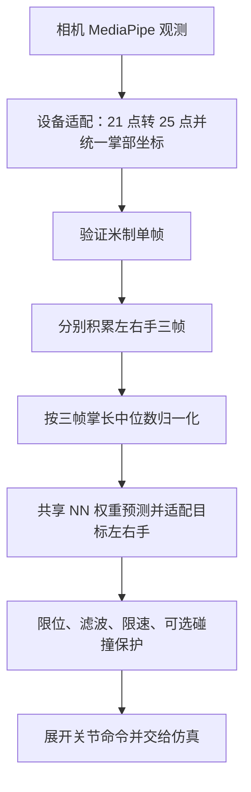

# 相机手部链路：从数据到动作，以及修改的影响

这份说明面向能读 Python 基础、但不容易看穿库调用和类封装的读者。选定路线是 **`hand control --source camera --backend nn`**，先以右手 L21 为例；每侧输出 17 个独立关节角。其他手型维度由规格决定。

先回答三个问题：数据在这里是什么？这个对象记住了什么？这里变了以后，谁会受到影响？不必先精读所有模型层。

## 1. 从哪里开始读

`python -m teleoperation hand control ...` 的命令分派在 [cli/__init__.py](../src/teleoperation/cli/__init__.py) 的 `main()`。参数由 [cli/schemas.py](../src/teleoperation/cli/schemas.py) 的 `hand_control()` 配置，默认使用统一手部 profile；`_handler` 指向 [applications/hand_control.py](../src/teleoperation/applications/hand_control.py) 的 `run(args)`。

这里的 `args` 是命令行参数的集合。`specs` 是目标规格字典，键如 `('l21', 'right')`；规格包含关节名称、角度限位、自由度及耦合关系。NN 权重还要与目标规格及输入规范匹配，不能靠改标签兼容。

下面是已选相机、NN、L21 分支的阅读骨架，**不是可直接运行的替代代码**。实际 `run()` 还负责参数检查、资源清理、记录和其他分支。

```python
# 初始化阶段：对象在循环外创建，循环中反复使用
specs, retargeter = _selection(args)  # 选择目标规格，并加载模型
scene, executor = _scene(specs, args.headless)
commands = _commands(args, specs, scene)
camera = MediaPipeCameraWorkflow(...)

# 逐帧阶段
window = camera.next_window()       # 采集 + 坐标处理 + 三帧历史 + 归一化
# 实际 run 在 window 为 None 时创建双侧缺失窗口，仍继续处理
results, accepted, targets = _process(window, specs, retargeter, commands)
for command in accepted.values():
    executor.apply(command)         # 把已接受命令交给场景
scene.step()                       # 推进仿真
```

`results` 是算法原始求解结果；`accepted` 是经过命令策略的实际命令；`targets` 是用于显示/记录的人手目标信息。**求解结果不等于实际执行命令。** 非 L21 的正式整机器人输出另经 `AcceptedRobotOutput` 提交，不要把以上 L21 执行段直接套到所有目标。

## 2. 跟着一份数据走



以下形状均指一只有效手；缺失侧以 `None` 表示。

| 所在位置 | 数据与形状 | 单位 / 需要知道的变化 |
|---|---|---|
| `RawHandFrame.world_hands[side]` | `(21, 3)` | MediaPipe world 米制点；不要与图像 normalized 点混用 |
| `UnifiedHandPipeline` 中的 `canonical.hands[side]` | `(25, 3)` | 转换点布局与掌部坐标后仍是米 |
| `TemporalBuffer.append()` 刚返回的窗口 | `(3, 25, 3)` | 三帧米制点；尚未按掌长缩放 |
| `normalize_hand_window()` 返回的窗口 | `(3, 25, 3)` | 无量纲，`units='1'`；掌长米值另外保存在 metadata |
| `SharedJointNNRetargeter.retarget()` 的 `tensor` | `(1, 3, 25, 3)` | 增加 batch 维度，1 表示本次一只有效手 |
| `self.model(tensor)` | `(1, D)` | 正式目标手模型预测独立关节角，L21 的 D=17 |
| `HandJointResult.positions` | `(D,)` | 已转换目标左右手约定的独立关节角，弧度 |
| `HandJointCommand.positions` | `(J,)` | 限制运动后展开的原生关节命令，弧度；J 为展开关节数 |

L21 的 D=J=17；其他手型可能有耦合，D 与 J 不相等。`HandWindow` 只是容器名称，归一化前后都用它，**类型和形状相同不代表单位相同**，需要看 `metadata`/`units`。

实际调用位置依次是：

1. [hand_realtime.py](../src/teleoperation/applications/hand_realtime.py) 的 `MediaPipeCameraWorkflow.next_window()`：取得原始观测、设置相对秒时间戳，交给 pipeline。
2. [hand_processing.py](../src/teleoperation/applications/hand_processing.py) 的 `UnifiedHandPipeline.process_observation()`：相机适配 → 验证 → 加入窗口 → 归一化。相机单帧几何算法在 [processing.py](../src/teleoperation/retargeting/hand/processing.py)。
3. [interface.py](../src/teleoperation/retargeting/hand/interface.py) 的 `SharedJointNNRetargeter.retarget()`：验证输入规范 → 模型推理 → 左右手角度适配 → 包装结果。
4. [joint_commands.py](../src/teleoperation/retargeting/hand/joint_commands.py) 的 `JointCommandPipeline.update()`：输入有效性/时间检查 → 限位 → 滤波 → 再限位 → 按共同比例限速 → 可选碰撞投影 → 保存本次接受角度 → 展开命令。
5. [hand_executor.py](../src/teleoperation/simulation/hand_executor.py) 的 `HandExecutor.apply()`：验证目标和关节耦合，将命令交给绑定的场景回调。应用入口再推进仿真。

## 3. 类究竟封装了什么

`buffer = TemporalBuffer()` 创建一个具体对象；`self._buffers` 是这个对象保留的数据；`buffer.append(frame)` 会读取并改变这些数据。下一次调用看到的是更新后的历史，而不是全新的空对象。

| 对象 | 创建者及位置 | 对象保留的内容 | 为什么影响后续调用 |
|---|---|---|---|
| `MediaPipeCameraWorkflow` | `hand_control.run()`，循环外 | 采集源、pipeline、起始时间 | 复用设备和历史；`release()` 关闭采集源并清空处理历史 |
| `UnifiedHandPipeline` | 相机 workflow 初始化 | 设备适配器、buffer、当前来源、当前手数据 | 切换设备时清历史；当前手数据仍是米制单帧 |
| `TemporalBuffer` | pipeline 初始化 | 左右手各自的最近三帧 | 决定是否预热完成；缺手默认清空该侧 |
| `SharedJointNNRetargeter` | `_selection()` 构建后端 | 模型权重、目标规格、运行设备 | 重复使用已加载模型；本对象的推理不保留三帧历史 |
| `JointCommandPipeline` | `_commands()`，控制循环外 | 上次接受角度、滤波值、时间、滤波器、统计 | 相同预测角度在不同历史和时间间隔下，实际命令可能不同 |
| `HandExecutor` | `_scene()` | 目标规格及目标到执行回调的绑定 | 确保命令交给正确目标；不承担三帧缓存或滤波 |

缺手时的状态变化也属于功能。假设只看右手，A、B、C、D 是**示意帧名称，不是实测值**：

| 输入 | 右手历史 | 窗口 / 执行效果 |
|---|---|---|
| 有效 A | A | 未准备好；命令保持初始或上次接受角度 |
| 有效 B | A、B | 仍未准备好 |
| 有效 C | A、B、C | 得到第一个完整窗口，可进行推理和命令更新 |
| 有效 D | B、C、D | 自动丢掉最旧帧，继续处理 |
| 右手缺失 | 清空 | 右手结果无效，命令保持；左手可独立继续 |
| 再次出现有效右手 | 从一帧开始 | 重新积累三帧，不能立即复用缺失前历史 |

切换 camera / visionpro 时统一 pipeline 清空两侧历史；整体契约错误也会 reset 后抛出异常。命令端缺失保持会重置滤波种子和有效输入计时，但保留上次接受角度，并记录已发保持命令的时间。恢复时使用这些时间限制移动幅度，不会直接跳到最新预测角。

**因此不要把这些对象的创建搬进逐帧循环。** 否则会丢掉历史、反复预热或改变滤波与限速行为。

## 4. 关键库函数在这里做什么

| 实际调用 | 在这条链路中的含义 | 修改时要检查什么 |
|---|---|---|
| `deque(maxlen=3)` | 最多保存三帧，满后自动丢最旧帧 | 时间顺序、预热与恢复；只改成五帧会被下游固定三帧契约拒绝 |
| `np.stack(tuple(buffer), axis=0)` | 把三份 `(25,3)` 合成 `(3,25,3)`，新增时间维 | 改 axis 会改变维度语义，而非仅改变写法 |
| `points - points[:, 0:1]` | 每帧减掉本帧腕点；NumPy 广播到该帧所有点 | 腕点索引及形状；不是只对第一个点运算 |
| `np.median(frame_lengths)` | 三帧掌长取一个中位数，三帧统一除以它 | 改为逐帧分母会改变模型输入数值和时间关系 |
| `torch.as_tensor(...).unsqueeze(0)` | 转成指定设备上的 float32 张量，再加 batch 维 | 输入 shape、dtype、CPU/GPU 位置 |
| `model.to(device).eval()` | 放到目标设备，并选择模型推理行为 | `eval()` 与关闭梯度不是一回事 |
| `with torch.no_grad()` | 不记录本次推理的梯度计算图，减少开销 | 这里只推理；训练阶段需要梯度 |
| `self.model(tensor)` | PyTorch 模块的调用入口最终执行 `forward()` | 跨文件跳转到 [transformer.py](../src/teleoperation/retargeting/hand/transformer.py)；输出为 `(batch,out_dim)` |
| `.detach()[0]` / `.cpu().numpy()` | 取 batch 中首项，最后转回 CPU NumPy 数组 | `[0]` 去掉的是 batch 维，不是取第一个关节 |
| `np.clip(result.positions, *spec.bounds.T)` | 对每个关节角应用自身上下限 | `(D,2)` 的 bounds 转置为 `(2,D)`，`*` 解包成下限和上限两个参数 |
| `ExitStack.enter_context()` / `callback()` | 统一登记资源，退出时按逆序清理 | 摄像头、仿真和文件能否在异常时关闭 |

左右手“共享 NN”指共享目标手模型权重；当前实现是在循环中分别对有效侧推理，不是自动组成双手 batch。模型的 `reset()` 无需清三帧历史，因为历史在输入 pipeline 中。

限位示意：若一个关节允许 `[0,1]` 弧度，而预测 `1.2`，`np.clip` 先得到 `1.0`。这只是**示意数值**；随后还有滤波、限速和可选碰撞处理，所以最终执行角度不一定为 `1.0`。

## 5. 如何判断一次修改的影响

先写清楚四件事：改了哪个函数；输入/输出/状态哪里改变；谁调用它；用什么固定输入比较改前与改后。测试中的固定输入通常比实时相机画面更适合定位数值变化。

| 想修改的地方 | 直接影响及继续追踪的路径 | 现有验证入口 |
|---|---|---|
| 相机坐标、21→25 点转换 | 单帧坐标 → 归一化窗口 → NN/dex 输入；也检查其他调用相机处理器的路线 | `tests.test_world_hand_pipeline`、`tests.test_unified_hand_inputs` |
| 三帧缓存、缺手或 reset | 第几个输入开始有效、是否残留旧帧、另一侧能否继续 | `tests.test_unified_hand_inputs` |
| 掌长分母或单位 | 相机与 VR 共用归一化函数及相关训练/导出消费者；涉及权重输入兼容性 | `tests.test_unified_hand_inputs`、`tests.test_world_hand_pipeline` |
| NN 输入、输出或左右手适配 | 模型兼容性、每侧关节角、后续命令；也检查训练和导出 | `tests.test_joint_checkpoints`、`tests.test_unified_hand_inputs`、`tests.test_hand_control_cli` |
| 滤波、时间或限速 | 原始 NN 解可能相同，但执行轨迹和保持恢复不同；NN/dex 都使用命令策略 | `tests.test_joint_commands`、`tests.test_hand_control_cli` |
| 目标规格或耦合展开 | 关节顺序、D/J 维度、模型匹配、命令、回放及执行 | `tests.test_joint_commands`、`tests.test_hand_control_h5`、`tests.test_hand_control_cli` |
| 仅注释与阅读文档 | 改变解释与帮助文本，应核对可执行语句未变 | 去掉 docstring 后的 AST 对比、相关回归测试 |

这些是查找起点，不是穷尽的依赖图。追踪消费者时，在仓库根目录用 `rg -n '类名或函数名' src tests` 查看调用位置，再核对实际分支；搜到名字不等于运行时一定经过那里。

本轮相关测试可在仓库根目录的 PowerShell 中运行：

```powershell
$env:PYTHONPATH = Join-Path (Get-Location).Path 'src'
$env:PYTHONUTF8 = '1'
& 'D:\Anaconda\envs\teleoperation\python.exe' -m unittest tests.test_unified_hand_inputs tests.test_joint_commands tests.test_hand_control_cli -v
```

测试包含固定观测、真实 NN 与 PyBullet 以及 H5 输出检查；采集输入可被替换，不等于验证了真实摄像头、VR 网络或实体设备。dex 独立环境缺失时相关用例会跳过，不能把跳过算成已验证。影响共享运行行为时，按仓库规则再运行 `python -m unittest discover -s tests`，并视改动补对应硬件验收。

## 6. 这份说明的边界与本轮改动

这里讲的是正式统一相机 NN 链路；既有相机 profile、训练/导出路线、机械臂及显式上游 TransHandR VR 路线仍有各自入口。不要因为看到相近类名就删掉一条路线；对照[当前接口](current-interfaces.md)和[统一手部输入](unified-hand-input.md)检查消费者。本文没有移植、修改或验证上游 VR 数值算法。

第一轮保留全部类、函数签名、数值语句、权重与资源生命周期；新增这份阅读说明和 README 入口，在主流程、缓冲、归一化、推理、命令策略处补中文说明，并纠正 `PoseTransformer.forward()` 输出形状的过时注释。Python 的 `__doc__` 帮助文本因此会变化。

修改前基线：`9c65b6bc218d1bb79282c5fc84778df7396c7692`；检查点：`checkpoint-20261107-2333-hand-reading-guide`。

查看具体差异：`git diff checkpoint-20261107-2333-hand-reading-guide -- src/teleoperation README.md docs/hand-camera-reading-guide.md`。将来真正调整封装时，也沿用“修改位置 → 数据/状态变化 → 消费者 → 验证结果”这四项来说明影响。
