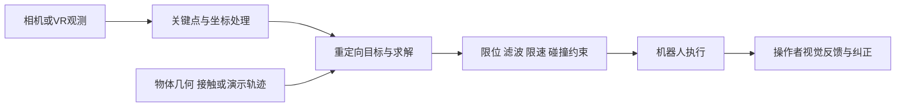

# 灵巧手运动重定向：文献综述与精读路线

整理日期：2026-11-09。范围：本地 `outputs/literature/retargeting/` 中的 9 篇固定版本论文。本文依据这些 PDF 的方法与实验正文整理；不代表已经复现，也不据此判断最新发表或开源状态。所有页码均为 PDF 从首页起的物理页码。

**建议先读本文的“综述正文”，再用“逐篇阅读卡”打开原文。第一轮精读 GeoRT 和 Key Objectives，随后用 DexPilot 补优化背景。** 文件名前面的编号只是下载顺序。

## 1. 先明确这组文献共同回答的问题

人的手和机器人的手在尺寸、关节轴、自由度、耦合关系与指尖可达区域上不同，因此不存在一个天然正确的逐关节复制关系。重定向研究必须先选择“什么应该被保留”：手形、局部运动方向、捏合意图、接触关系、物体运动，还是任务结果。优化器和网络都是实现这些选择的工具。

阅读时把完整链路拆开：

比较两篇论文时，先确认它们改的是哪一环。感知更准、操作者更容易纠错、优化目标更合理，都可能提高成功率；系统成功率的提升不能单独归因于重定向损失。

| 研究线 | 代表论文 | 主要保留什么 | 你应带走的问题 |
|---|---|---|---|
| 在线几何优化与目标设计 | DexPilot、Key Objectives | 指尖相对关系、朝向和捏合意图 | 相互冲突的目标应怎样取舍？ |
| 学习整个几何映射 | GeoRT | 局部运动方向、可达空间覆盖、响应均匀性 | 为什么单帧像不像不足以定义映射质量？ |
| 物体感知与功能迁移 | DexOAK、ObjRetarget、DexMachina | 手物关系、接触、物体运动与操作功能 | 姿态正确之后，为什么任务仍可能失败？ |
| 通用遥操作与数据采集 | AnyTeleop、OPEN TEACH | 可操作性、实时反馈、数据效用 | 好用的系统如何被验证？ |
| 显式约束与安全 | Kilohertz-Safe | 几何跟踪下的关节和碰撞可行性 | 训练惩罚与执行时约束有什么差别？ |

这些是问题之间的联系，不表示论文之间存在严格的继承关系，也不是一条“新方法全面取代旧方法”的时间线。

## 2. 综述正文：从几何对应走向功能与约束

### 2.1 从关节复制转向任务空间：应该保留哪些几何量

由于人手与机器人手的运动学结构不一致，直接复制关节角难以稳定保留精细操作所需的指尖关系。DexPilot 将这一问题转化为指尖任务空间向量的优化，并通过距离投影和切换权重强化接近捏合时的指尖闭合。其意义在于明确区分“手形视觉相似”与“能够实际夹住物体”：感知给出的两指距离即使只有小误差，也可能使机器人无法建立接触。[3，pp.5–7，VII-A、Table I]

然而，任务空间目标仍然存在选择与冲突。Key Objectives 将全局手位姿、腕部相对指尖位置、指尖间相对位置和指尖朝向放进统一优化，再通过消融分析各自作用。其结果表明，捏合距离处理对精细夹取尤其关键，指尖朝向对勾取杯柄等动作有明显影响；放松腕部位置、改以拇指尖定位可以改善部分几何误差，但操作者也能通过移动手腕补偿误差，使这种指标优势未必等幅转化为真实任务收益。[2，pp.2–5，Eq.(1)–(6)、Table I、Fig.2–5]

两篇论文共同说明，目标设计需要结合动作功能与感知误差。DexPilot 用投影处理“需要闭合”的操作意图，Key Objectives 进一步分析连续权重、距离重缩放与朝向目标。因而，综述不宜写成“增加更多目标即可提高性能”；更准确的判断是：**不同目标保护不同操作能力，同时可能竞争有限的机器人自由度。** 对低自由度和耦合手型，这种取舍尤其值得作为实验问题，但上述论文尚不能直接证明你的目标手上应采用哪组权重。

### 2.2 从单姿态匹配转向整个映射的性质

几何优化通常逐帧寻找一个合适姿态。GeoRT 将注意力转向整个映射函数：除了当前姿态是否合理，还要求操作者沿某个方向移动时机器人响应方向一致，能够利用目标手的可达指尖空间，并在不同区域保持较均匀的控制灵敏度。方法利用方向保持、覆盖、局部平坦性、捏合对应与碰撞损失训练神经映射，将主要优化成本移至离线训练。[1，pp.3–5，II-B–G、Eq.(2)–(9)、Algorithm 1]

这里的“平坦性”描述输入到输出映射的局部二阶变化，不能直接等同于时间序列低通滤波。一个系统可以输出时间上很平滑的轨迹，却在某些人手区域几乎不响应；反过来，映射灵敏度均匀也不能消除输入设备的跟踪噪声。覆盖目标关注机器人指尖空间的利用率，也不能自动解释为每一种多指联合姿态都可达。[1，pp.3–5，Fig.4–6、Eq.(4)–(5)]

在作者报告的 Allegro 实验中，GeoRT 的方向保持指标由对比方法的 0.73 提升至 0.94，覆盖由 38% 提升至 90%。但作者也指出，这些评价与训练目标直接相关，因此还需要真实任务证据。其真实实验采用 Manus 手套、Vive 腕部跟踪、Allegro 与 Franka，主要考察抓取，不能据此推断单目相机、严重遮挡、复杂手内操作或任意手型都有同样收益。[1，p.5，Table II–III；pp.6–7，III-B–C]

从研究角度看，GeoRT 与 Key Objectives 是互补的：前者帮助定义整个控制映射的品质，后者帮助分析具体动作需要哪些几何量。理解两者后，再考虑是否有必要修改模型结构；否则很容易把目标定义问题误当作网络容量问题。

### 2.3 从手形迁移转向手物关系与操作功能

前述方法主要根据人手运动生成机器人手姿态，但相同的手形在不同物体上可能产生不同接触。DexOAK 和 ObjRetarget 将物体信息纳入重定向，使接触保持与手物穿透成为直接处理的问题。DexOAK 面向人类操作轨迹，结合物体感知的运动学处理与后续物理跟踪；ObjRetarget 则同时考虑拟人机械臂约束、手部多面体几何以及手物关系。[5，方法与实验，详见第4节；8，pp.3–6，III–IV]

DexMachina 进一步强调功能重定向：目标不只是生成几何相似的机器人动作，还要在物理仿真中完成双手物体操作。它以运动学参考为起点，结合强化学习、接触相关设计和课程机制生成动态可行行为。因此，它与在线遥操作映射不是同一任务设置：运行时信息、训练预算与评价终点均需要单独比较。[6，pp.3–6，方法；p.9，局限]

这组工作说明，几何相似、接触合理与动态成功构成不同层次的证据。接触距离小不代表摩擦和受力足以完成任务，运动学重放成功也不等于策略可以面对新物体自主操作。阅读时必须标清：论文输出的是一帧关节角、整段参考轨迹，还是一个利用状态反馈的控制策略；真实实验又验证了哪一层。

### 2.4 从单一算法走向可用系统与数据效用

AnyTeleop 将研究重点放在多种机器人、相机配置与仿真/真实环境的统一支持。其手部采用带关节限位和时间正则的向量匹配优化，机械臂运动则交给单独的运动生成模块。这种模块化分工使感知、手部重定向与机械臂运动可以分别运行和分析。[4，pp.3–6，系统架构、IV-C–D、Eq.(1)]

OPEN TEACH 则以 VR 手部跟踪、视觉反馈和机器人适配为核心，展示系统可用性与示教数据对下游学习的价值。它并没有对所有手指统一采用复杂优化：原文手部适配主要结合关节角映射和拇指逆运动学。其用户研究、长时任务与策略学习实验，提醒我们把“操作者是否能迅速纠错”纳入遥操作评价，而不只比较离线姿态误差。[7，pp.4–6，IV-C–D；p.8，Table III–IV]

系统层证据也有比较边界。AnyTeleop 的部分真实机器人基线数据直接来自既有论文；OPEN TEACH 对 AnyTeleop/Holo-Dex 的新手对比限于不需要机械臂移动的任务。两者都提供了有用实验，但不足以隔离所有感知、交互与控制因素，不能把系统优劣直接写成核心重定向算法的优劣。[4，p.7，VI-B、Table IV；7，p.8，V-F]

### 2.5 从软惩罚走向执行时显式约束

训练碰撞损失能够鼓励较安全的输出，但不等于每次执行都满足几何约束。Kilohertz-Safe 围绕当前关节状态线性化正运动学与约束，在关节增量空间构造凸二次规划，并引入控制屏障函数处理安全集合。其方法价值是将跟踪与约束放到同一求解框架中。[9，pp.2–4，Eq.(2)–(7)、III-B]

不过，需要区分理论条件、离散实现和实验结果。论文 p.7 的 Fig.5 明确描述离散控制与时延下少数帧仍有毫米级阈值违反；p.5 的 Table I 报告平均计算时延 9.05 ms、99百分位 13.42 ms、100 Hz 截止期满足率 85.82%。因此，本文将其定位为“显式约束与毫秒级计算的研究”，不将标题中的 Kilohertz 当作完整系统达到 1 kHz 的实测证明。[9，pp.5–7，Table I、Fig.4–5]

综合这些工作，适合本项目的研究问题应由具体失败出发：是指尖闭合不了、指向不对、局部响应失真、接触丢失，还是执行后碰撞？只有先明确失败属于哪一层，才能选择相应目标和证据，而不是把九篇论文的损失全部叠加。

## 3. 阅读顺序与投入分配

| 次序 | 论文 | 建议投入 | 本轮必须完成的产出 |
|---|---|---|---|
| 1 | GeoRT | 两次各60–90分钟 | 画出训练/推理图；解释五类目标为何不等价 |
| 2 | Key Objectives | 两次各60–90分钟 | 把一个目标、一个消融、一个失败现象对应起来 |
| 3 | DexPilot | 60–90分钟，先VII-A | 写出捏合投影发生前后目标的变化 |
| 4 | AnyTeleop | 45–60分钟 | 标清感知、手部求解、机械臂规划的边界与频率 |
| 5 | OPEN TEACH | 45–60分钟 | 分开记录系统任务、新手研究和下游学习结果 |
| 6 | DexOAK | 先45分钟浏览，再决定精读 | 写清物体信息、运动学处理与物理跟踪的分工 |
| 7 | ObjRetarget | 先45分钟浏览 | 比较其接触/几何目标与 DexOAK 的信息条件 |
| 8 | DexMachina | 先60分钟浏览；做功能迁移再精读 | 区分参考运动、外部辅助和学得策略 |
| 9 | Kilohertz-Safe | 60–90分钟 | 推出一阶FK近似与QP，检查安全和速度证据 |

这些是学习预算，不是读懂的期限。若你现在主要研究手部映射，先完成1–3；若主要研究VR系统，4–5可提前；若研究离线操作数据迁移，6–8需要提高优先级。

## 4. 逐篇阅读卡

### [1] GeoRT：先学“如何定义一个好映射”

- **原文入口**：p.2 Fig.2 解释非线性空间差异；pp.3–4 的五条准则；p.4 Fig.6 与 Algorithm 1；p.5 Eq.(9)、Table II–III；p.7 真实实验条件。
- **输入/输出**：腕部坐标系的人手指尖位置 → 机器人关节角；原文实现是按手指分开的 MLP。无配对人手-机器人姿态标注，不等于无需人手采集、机器人数据或训练。
- **训练与部署**：人手探索轨迹近似源空间，仿真采样近似目标空间；原文训练使用神经FK与碰撞分类器，解析可微FK也被允许。部署主要用映射网络，不能把训练辅助模型都算成必需在线模块。
- **核心机制**：方向保持限制局部运动方向；Chamfer代理项鼓励覆盖；二阶有限差分鼓励局部响应均匀；捏合项限制近距离指尖；分类器损失抑制自碰撞。
- **证据**：p.5 Table II 的几何指标；Table III 的抓取首次成功率为87.5%，对比列为55%与42.5%。这些是本文实验条件下的报告值；本文不把未交代清楚的试验规模补写出来。
- **阅读自测**：一个只把人手动作缩小十倍的映射，为什么可能方向正确但覆盖差？只满足覆盖和平坦性，为什么还可能方向反转？
- **与项目联系**：先对照 `learning/losses.py`，检查目前六项损失是否真正约束方向导数、空间覆盖和映射二阶变化。名称类似或都使用FK，不代表已经实现 GeoRT。

### [2] Key Objectives：学会读消融，而不是只记一个总损失

- **原文入口**：p.2 Eq.(1)–(5)；p.3 Eq.(6)、Table I、III-A；p.4 Fig.2–4；p.5 对腕部与关节正则的讨论。
- **输入/输出**：人手指尖、DIP等关键点和全局位姿目标 → 联合的机械臂与手部关节目标。它的全局位姿选择不能无条件移植到固定手腕的独立手场景。
- **方法**：拇指全局位置与较弱腕部朝向；腕到指尖向量；拇指到其他指尖的连续加权与距离重缩放；DIP到tip向量；关节姿态和逐步变化正则。
- **证据**：真实实验为 Vision Pro、Panda、LEAP；20 Hz求解，再插值发送。Fig.4 两位操作者；箱体、杯柄、螺钉三类任务，不同任务分别比较耗时或成功率。几何实验还包含 Shadow。
- **最值得精读的反例**：A2不做捏合距离重缩放，部分位置误差很低，真实精细夹取仍较差。作者将其与跟踪误差联系起来。先解释这个现象，再看为什么DIP→tip朝向会影响杯柄勾取。[pp.3–4]
- **阅读自测**：A5用腕位置替代拇指位置，几何误差和任务表现的变化为何不同？A6同时去掉多个项，为什么不能用它孤立证明某一项的因果作用？
- **边界**：这是特定目标组合、平台和任务上的消融，不是所有机器人手的通用权重排序。A2、A4模拟部分既有设计，也不等于完整重实现相应基线。[p.5，III-C]

### [3] DexPilot：学“精细捏合为何要改变目标”

- **原文入口**：先读 pp.5–7 VII-A、Table I、Fig.8–9；再读 p.9 Table II 和实验；最后才补感知网络。
- **输入/输出**：完整系统由RGB-D观测估计手部状态，手部重定向利用人手模型中的任务空间向量优化 Allegro 角度；机械臂另由RMP生成运动。
- **方法**：向量误差、接近捏合时的高权重与距离投影、关节角正则；SLSQP求解并以前一结果初始化，输出还经过低通滤波。[pp.5–7]
- **证据**：15项物理任务，每项每位操作者连续5次、两位操作者，比较成功率与完成时间。[p.9，Table II及正文]
- **关键代价**：投影有利于抓小物体，也可能导致释放困难；小方块任务对此有直接讨论。[p.9；p.12 Fig.18]
- **阅读自测**：一段人手距离缓慢越过投影阈值的输入，会造成怎样的目标变化？滤波缓和了什么，又引入什么响应代价？
- **移植提醒**：原文主手指远端与中间关节采用相等约束；任务向量还涉及局部坐标系。不能只抄目标函数外形，就宣称与论文等价。[p.7]

### [4] AnyTeleop：学系统分工与公平比较

- **原文入口**：pp.3–5 系统图与IV；p.5 IV-C Eq.(1)；p.6 IV-D、Table II；p.7 Table III–IV；p.9 VIII失败模式。
- **输入/输出**：RGB/RGB-D、多相机选项 → 手部关键点与全局腕位姿 → 手部关节目标与机械臂运动轨迹；相机融合和机器人适配各有职责。
- **方法**：手部向量匹配带限位、上帧正则；机械臂使用CuRobo生成轨迹。面向非拟人结构仍需手动指定关键点对应关系。[p.5]
- **证据**：Table II分模块计时；Table III比较示教数据对同一学习流程的作用；Table IV真实任务基线采用既有论文报告，而非同场重新采集全部基线。
- **频率要分层**：设计中的感知和重定向25 Hz、运动生成120 Hz；作者说明同机同时运行难达最佳吞吐，可分机部署。优化一次耗时不等于新目标的实际更新频率。[p.6]
- **阅读自测**：如果手部求解提速一倍，但感知仍25 Hz，操作者能获得多少新增信息？同一个手部算法换成更稳定感知后成功率提高，应归因到哪里？
- **边界**：快速动作丢跟踪、自遮挡仍是明确失败模式。[p.9]

### [7] OPEN TEACH：学“好用”与“能产生好数据”如何分别验证

- **原文入口**：pp.4–6 IV-C–D、V；p.8 Table II–IV、V-F；pp.8–9 VI；附录pp.13–14个人结果。
- **输入/输出**：Quest 3手部跟踪与腕部运动 → 各机器人适配后的动作；同时提供视觉反馈、暂停和精细分辨率调整。
- **方法**：主要手指按估计角度映射，拇指用特定空间映射与IK；机械臂根据掌部坐标和腕部运动控制。应把它作为完整系统论文阅读。
- **证据**：展示38项任务；15名新用户研究；10项任务的下游学习评估。这三组实验分别支持覆盖范围、可操作性、数据效用，不能混成一个成功率。
- **比较范围**：与其他系统的新手对比限于无机械臂运动的翻块和捏合等任务，不能推成完整臂手能力的统一排名。[p.8，V-F]
- **频率要分层**：VR可提供90 Hz姿态；原文Allegro目标流60 Hz，底层PD300 Hz，不同机械臂和移动平台另有频率。[pp.5–6、p.8 Table II]
- **阅读自测**：为什么操作者的视觉纠正可能掩盖映射误差？若要证明某个损失提高可用性，你会如何保持输入设备和反馈一致？
- **边界**：VR内置跟踪仍受遮挡与误识别影响；校准便利不代表可跳过机器人坐标和动作适配。[pp.8–9]

### [5] DexOAK：学会分开评价参考轨迹与动力学细化

- **原文入口**：pp.2–4 III–IV；p.5 Table I；p.6 Table II–IV；p.7 V-F；p.8 Table V与结论。
- **输入/输出**：人手运动关键点和物体网格采样点，表达在逐帧腕坐标中 → 机器人腕位姿与手指关节参考。运动学阶段按手处理，双手的动力学交互留给后续阶段。
- **方法链**：带物体锚点的交互图优化生成种子 → 监督网络摊销求解成本 → 无标签接触目标微调 → 另经任务相关残差RL进行物理跟踪。接触目标区分贴近表面、对应表面区域、从同一侧接近；单纯表面距离不能独立排除穿透。[pp.2–4]
- **最有用的证据**：p.5 Table I所有行采用同一ManipTrans残差RL后端，较适合分析参考轨迹贡献。完整方法的接触覆盖CC为21.9%、指尖位置误差TPE为3.21 mm、SR_MT为48.2%；IG优化器参考对应19.6%、3.50 mm、43.2%。其中CC要求一帧里所有应接触指尖都满足接触条件，不能把它解读为逐指平均接触率。
- **速度边界**：p.6 Table III的108.9 Hz是预训练模型跨域零样本处理目标数据时的运动学阶段有效吞吐，排除后续RL；本域包含训练的计算口径又不同。不能据此写成整个系统在线108.9 Hz。
- **实机边界**：p.7 V-F与p.8 Table V共46/56次成功，但执行的是筛选出的仿真成功轨迹，且开环重放前人工恢复物体初始位。它支持这些条件下的硬件可执行性，不是随机示范到实机的无条件成功率。
- **阅读自测**：如果贴近物体表面的误差很低，为什么还需要方向、穿透约束和动力学策略？网络输入去掉物体点云，与损失去掉物体锚点，是否是同一种消融？
- **复现提醒**：该v1正文p.5与补充p.10中碰撞margin、网络配置、微调轮数有差异；精读时建立待核查列表，实际实现需进一步对照官方代码，不能默认为唯一配置。

### [8] ObjRetarget：先看懂局部接触几何，再看整条链

- **原文入口**：p.3 III-A–B；pp.4–5臂平面先验；p.5 III-C–D、Eq.(9)–(15)；p.6 Table I；p.7 Table II–III；p.8局限。
- **输入/输出**：RGB-D示范经人体与物体恢复得到骨架、物体点云轨迹和交互信息 → 机械臂轨迹与接触阶段的手部关节命令。它包含序列恢复与优化，不宜归为已证明高频实时的在线遥操作映射。
- **方法**：初始神经映射给出轨迹；机械臂目标加入肩肘腕平面的软先验与时序平滑；接触时用掌心、指尖、邻指尖和物体接触点构造局部四面体簇，约束手物几何；按接触状态切换并同步执行。
- **公式细读提醒**：p.5 Eq.(12)实际写的是对应边向量之差，不是两个标量边长之差，不能只凭正文“edge-length”一词断言该项旋转不变；Eq.(13)才明确比较各自局部坐标中的接触点。原文接触阈值写0.05 cm，即0.5 mm，复现时应核对代码与噪声条件，不自行更改单位。
- **证据**：RealMan双臂配6自由度Inspire手，六任务各20次，Table I合计91/120，约75.8%。Table II–III分别分析手部几何和臂部先验，不能把所有结果都归因于一个手部损失。
- **边界**：原文未给完整管线时延或Hz；p.8指出动态反馈尚未充分利用。结果支持所测硬件与任务上的改进，不代表任意手型或任意物体的通用迁移。
- **阅读自测**：手腕末端轨迹相同，为什么肘部运动仍可能很不自然？接触局部几何相似，为什么仍可能滑落？

### [6] DexMachina：理解“功能迁移”为什么需要物理与课程

- **原文入口**：p.3问题定义；pp.4–6方法、Algorithm 1；pp.7–8实验；p.9局限；p.15动作和接触定义；p.17 B.4评价。
- **输入/输出**：给定物体、人手与物体的一条稠密示范、特定机器人双手 → 该物体/具身组合的反馈策略。它的目标是物体位置、旋转及关节状态跟踪，不是直接输出一个通用人手到机器人手映射。
- **方法**：运动学参考先经仿真消解穿透；运动和接触奖励辅助学习；训练初期由虚拟物体控制器帮助走完整条轨迹，随着能力提升逐渐撤除，最终辅助归零。腕动作是参考加残差，手指动作则是绝对关节位置。[pp.4–6；p.15]
- **证据**：ARCTIC的5个关节物体、7条示范；主比较4种手，另外2种用于具身分析。图中改善需要结合特定任务、模型和统一仿真实现理解。[pp.6–8]
- **指标边界**：p.17 B.4以物体部件跟踪的ADD-AUC定义评价，不能把图里所有“success rate”直接当完整操作的二元成功比例，更不能与ObjRetarget实机91/120混排。
- **作者明确局限**：p.9说明依赖仿真特权状态和高质量示范，手部资产误差可能影响结论，且尚无真实硬件验证。视觉策略与sim-to-real属于后续方向。
- **阅读自测**：只给物体状态跟踪奖励，为什么长序列接触难探索？虚拟控制器太早撤除、始终不撤除，分别会怎样影响学习与评价？
- **与项目联系**：如果当前目标是相机或VR在线控制，优先学习它如何区分“形似”和“功能成功”；只有计划开展离线物理策略迁移时，才深入其PPO与课程实现。

### [9] Kilohertz-Safe：学局部线性化与约束证据

- **原文入口**：p.2 Eq.(2)–(6)；p.3 Eq.(7)与Fig.1；p.4实验和时延定义；p.5 Table I；pp.6–7安全消融。
- **输入/输出**：人手几何特征、当前机器人状态及约束信息 → 关节增量，再更新关节配置。
- **方法**：把 `FK(q_prev + dq)` 一阶近似为 `FK(q_prev) + J*dq`；匹配残差产生二次目标，限位成为线性不等式；CBF进一步约束安全集合边界处的运动。
- **证据**：Wuji手仿真量化，真实实验主要是定性展示。Table I平均9.05 ms、标准差2.29 ms、99百分位13.42 ms、RT@100Hz为85.82%；这些分别反映均值、波动、尾部和截止期满足情况。
- **重要核对**：p.4计时包含姿态处理、重定向与约束优化，不含渲染、可视化、通信；不能直接与GeoRT单网络推理的1 kHz主张对比。Table I中的GeoRT为本文所评测链路的结果，不是对原文网络推理速度的重新定论。
- **安全边界**：p.5明确安全分数是几何间隙相对指标，不是完整物理安全模型；p.7承认少量阈值违反。理论安全性要结合模型、初始状态、可行性、采样与执行时延理解。
- **阅读自测**：为什么局部QP凸，不代表原始非线性碰撞问题全局已解决？一帧输入突变时，一阶近似依赖的“小步变化”条件是否仍成立？

## 5. 公式怎么读：先认清它在优化什么

用 `x` 表示人手几何，`q` 表示机器人关节，`g(q)` 表示机器人FK，`o` 表示物体信息，下面是帮助分类的示意式，**不是对某篇论文的精确复写**：

| 示意形式 | 对应问题 | 必问事项 |
|---|---|---|
| `min_q Σ w_i ||v_robot_i(q) - target_i(x)||² + R(q)` | 给定一帧，找一个合适姿态 | target是否缩放/投影？权重何时切换？R偏好零角还是上一帧？ |
| `q=f_theta(x), min_theta L(g(f_theta(x)))` | 学出整个映射 | 用什么采样定义训练空间？部署是否仍需要FK？ |
| `min_q L_hand + L_contact(q,o) + L_penetration(q,o)` | 保留手物关系 | 物体位姿、几何和接触标签从何而来？ |
| `a_t=pi(s_t, reference), max_pi E[Σr_t]` | 产生动态可行策略 | reference、反馈状态、动作和物理辅助分别是什么？ |
| `min_dq 0.5*dqᵀH*dq + cᵀdq, A*dq≤b` | 用局部凸问题处理约束 | 线性化点、积分步长、不可行处理和执行误差是什么？ |

每个关键公式写出六项：变量、单位、坐标系、优化对象、所需信息、计算时机。再给它一个动作例子，例如“拇指和食指距离由3 cm减到0.5 cm时，这一项要求机器人怎样动”。能说清这个例子，比逐字抄公式更有用。

对陌生知识按需补课：先理解FK与关节限位，再理解向量误差与雅可比；读GeoRT再补Chamfer和有限差分；读功能迁移再补策略、奖励与课程；最后读QP与CBF。不要让背景学习取代当前论文的问题理解。

## 6. 怎样判断作者真的证明了什么

| 作者展示 | 可以支持的判断 | 还应检查 |
|---|---|---|
| 重定向前后截图相似 | 给定案例的姿态具有合理性 | 是否有连续序列、失败例和定量评估？ |
| 几何误差下降 | 对应定义下匹配更好 | 指标是否与训练目标同源？真实接触是否改善？ |
| 仿真任务成功 | 给定模型与物理设定下能操作 | 是否使用真值状态、外部辅助或轨迹筛选？ |
| 实机轨迹重放成功 | 部分输出可转移到硬件执行 | 是否由仿真成功样本筛选？有没有独立反馈策略？ |
| 用户完成更快 | 系统操作效率提升 | 熟练度、顺序、设备、反馈和失败试次如何处理？ |
| 下游策略成功率提高 | 数据对指定学习流程有用 | 学习算法、数据量和训练预算是否相同？ |
| 平均耗时较低 | 平均计算开销较小 | 计时范围、尾延迟、截止期满足率与端到端延迟？ |
| 约束理论成立 | 在列明假设下有数学性质 | 离散实现、模型误差和执行违约是否评估？ |

把每条笔记分成“作者报告”“原文证据”“我的解释”“还需验证”。例如，不要只写“GeoRT覆盖好”，而写：“作者在Allegro的采样指尖空间评估中报告90%覆盖（p.5 Table II）；这支持该设定下空间利用改善，但尚不能代表我的耦合手型能覆盖所有联合姿态。”

## 7. 把阅读转为本项目能做的实验

以下是结合当前源码的阅读建议，不是本次已经实施的算法修改。

| 当前入口 | 已核对内容 | 对照阅读后的行动 |
|---|---|---|
| `src/teleoperation/learning/losses.py` | 六项为vec、pos、collision、thumb、tip_distance、thumb2 | 与GeoRT五准则建立公式级对照；不要按名称认定等价 |
| 同文件的 `tip_pos_loss` | 实际比较归一化的MCP→tip方向 | 分清方向误差与绝对位置误差，避免因pos名称误读 |
| 同文件的 `CollisionLoss` | 对选定FK点间距构造训练惩罚 | 对照Kilohertz-Safe，分开报告训练惩罚、执行保护和真实碰撞 |
| `src/teleoperation/retargeting/hand/dex_native.py` | 使用上游VectorOptimizer/SeqRetargeting | 与DexPilot距离投影逐项比对；当前dex后端名称不等于原论文方法 |
| `src/teleoperation/retargeting/hand/joint_commands.py` | 求解结果还有命令处理阶段 | 分别评估原始预测和接受命令，防止滤波掩盖映射问题 |
| `src/teleoperation/learning/hand_evaluation.py` | 包含指尖和捏合相关几何比较 | 与任务结果分开；各论文指标定义不同，不能直接拼数值 |

**推荐先做的实验问题**：在固定设备输入、目标手、数据划分和命令处理下，针对捏合的目标调整是否改善精细夹取，同时保留非捏合动作的可用范围？这是待验证假设，已有文献已研究捏合，不能直接称为新颖贡献。

具体执行顺序：

1. 选原始方法最常失败的一类动作，并保存输入片段，标注“无法闭合、方向错误、限位饱和、碰撞”等现象。
2. 先复核单位、坐标系、关键点对应和关节耦合；确认失败来自映射能力，而不是边界适配错误。
3. 按Key Objectives的思路，仅改变一个主要目标设计；同预算训练或求解，并保持执行滤波、限速与保护配置一致。
4. 开环固定输入比较几何与命令表现，再让操作者闭环执行任务。前者观察映射，后者允许人类补偿，二者不能互相替代。
5. 同时报捏合误差、指尖朝向、限位饱和、最小几何间距、命令变化、计算时延；若做真实任务，再报成功率和完成时间，并说明失败计时规则。
6. 同时保留非捏合动作，检查性能是否只是把手强行收紧换来的；跨操作者/场次测试时，训练、校准与测试数据明确分开。

若以后加入物体目标，先解决可获取的物体几何、位姿、接触信息与坐标一致性，再比较DexOAK/ObjRetarget；若要做功能策略迁移，再引入物理仿真与DexMachina。单纯在线手部映射不必一开始就承担这些信息和训练成本。

## 8. 第一次读论文：可以直接照做的90分钟

以GeoRT为例：

1. **0–15分钟**：看摘要、p.2 Fig.2、p.4 Fig.6。用自己的话写下输入、输出和“线性匹配为什么可能不够”。
2. **15–40分钟**：读pp.3–4。每条准则只写一个反例：去掉它，什么坏映射仍能满足其他条件？
3. **40–60分钟**：读p.4 Algorithm 1与p.5的实现、表格，区分训练阶段模型与在线阶段模型；记录每个指标的方向和定义。
4. **60–75分钟**：读pp.6–7真实实验，列出设备、机器人、控制方式、任务与结论范围。
5. **75–90分钟**：合上论文，解释覆盖与平坦性分别解决什么；再打开项目损失文件，记下“已对应、尚未对应、不确定”三类内容。

读完后应能写出五句话：研究问题、输入输出、关键机制、直接证据、适用边界。如果仍讲不清某条准则，只回读相关图和公式，不必从头重新翻译全文。第二篇就用Key Objectives的A1/A2/A3复核“误差低是否等于任务好”。

## 9. 固定版本与引用

下列编号用于本文定位，参考文献信息取自本地PDF；版本、页数和SHA-256另见本地 `outputs/literature/retargeting/manifest.json`。如用于正式学术写作，应按学校格式补全作者与出版元数据，并独立核对最终版本。

1. **GeoRT**. *Geometric Retargeting: A Principled, Ultrafast Neural Hand Retargeting Algorithm*. [arXiv:2503.07541v1](https://arxiv.org/abs/2503.07541v1)，8页。[本地PDF](../../outputs/literature/retargeting/01_GeoRT_2503.07541v1.pdf)。
2. **Key Objectives**. *Analyzing Key Objectives in Human-to-Robot Retargeting for Dexterous Manipulation*. [arXiv:2506.09384v2](https://arxiv.org/abs/2506.09384v2)，10页。本地v2首页日期为2025-12-24，应避免仅依据编号把该版本日期写成2025年6月。[本地PDF](../../outputs/literature/retargeting/02_Key_Objectives_2506.09384v2.pdf)。
3. **DexPilot**. *DexPilot: Vision Based Teleoperation of Dexterous Robotic Hand-Arm System*. [arXiv:1910.03135v2](https://arxiv.org/abs/1910.03135v2)，18页。[本地PDF](../../outputs/literature/retargeting/03_DexPilot_1910.03135v2.pdf)。
4. **AnyTeleop**. *AnyTeleop: A General Vision-Based Dexterous Robot Arm-Hand Teleoperation System*. [arXiv:2307.04577v3](https://arxiv.org/abs/2307.04577v3)，15页。[本地PDF](../../outputs/literature/retargeting/04_AnyTeleop_2307.04577v3.pdf)。
5. **DexOAK**. *DexOAK: Object-Aware Kinematic Retargeting*. [arXiv:2610.26762v1](https://arxiv.org/abs/2610.26762v1)，11页。[本地PDF](../../outputs/literature/retargeting/05_DexOAK_2610.26762v1.pdf)。
6. **DexMachina**. *DexMachina: Functional Retargeting for Bimanual Dexterous Manipulation*. [arXiv:2505.24853v1](https://arxiv.org/abs/2505.24853v1)，18页。[本地PDF](../../outputs/literature/retargeting/06_DexMachina_2505.24853v1.pdf)。
7. **OPEN TEACH**. *OPEN TEACH: A Versatile Teleoperation System for Robotic Manipulation*. [arXiv:2403.07870v1](https://arxiv.org/abs/2403.07870v1)，20页。[本地PDF](../../outputs/literature/retargeting/07_OPEN_TEACH_2403.07870v1.pdf)。
8. **ObjRetarget**. *ObjRetarget: An Object-Aware Motion Retargeting Framework with Anthropomorphic Arm Constraints and Polyhedral Hand Modeling*. [arXiv:2607.03828v1](https://arxiv.org/abs/2607.03828v1)，8页。[本地PDF](../../outputs/literature/retargeting/08_ObjRetarget_2607.03828v1.pdf)。
9. **Kilohertz-Safe**. *Kilohertz-Safe: A Scalable Framework for Constrained Dexterous Retargeting*. [arXiv:2603.29213v1](https://arxiv.org/abs/2603.29213v1)，8页。[本地PDF](../../outputs/literature/retargeting/09_Kilohertz_Safe_2603.29213v1.pdf)。

## 10. 本次整理的检查点

- 修改前提交：`3c528403db85a8d54217b080032c1b1c93a064c4`。
- 修改前annotated tag：`checkpoint-20261109-0101-literature-review`。
- 本次为文献与阅读文档整理；数值均为论文报告，未实施算法复现或新增性能实验。
