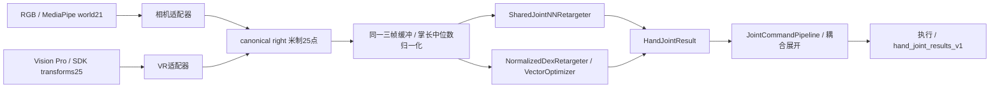

# RGB 与 Vision Pro 并列的手部重定向

RGB与Vision Pro通过各自设备适配器进入共同手部契约，独立选择目标手和NN/dex后端。当前接口与仍保留的局部分支见[接口说明](current-interfaces.md)。

## 正式链路



设备、目标手、算法是三个独立选择。L21、H1-2、GR1-T2、G1均支持两种设备和NN/dex；NN每种目标手使用一份shared权重，dex不需要NN权重或VR固定掌长标定。原始SDK矩阵必须先适配轴/拓扑，不能直接改标签成为MediaPipe坐标。

## 边界与数值

- `inputs/hand_adapters.py:VisionProMetricAdapter`只提取SDK矩阵平移、恢复解剖轴、建立掌基和canonical right，不导入优化器或网络。左侧轴为`(-y,-z,x)`，右侧`(-y,z,-x)`，均为proper rotation。这与既有native VR适配的手性恢复一致，不是TransHandR旧左→右模型反射。
- 相机适配复用`MediaPipePalmLocalProcessor('world')`。21点world转25点；原始图像normalized点仍用于记录/预览。新增4点为插值，不宣称与VR实际掌骨测量完全相同。
- `applications/hand_processing.py:UnifiedHandPipeline`将两个适配结果变成同一种`CanonicalHandFrame`，左右独立三帧缓冲，共用现有`validate_metric_hand_frame`与`normalize_hand_window`。坏掌/缺失清对应侧历史，恢复需3个有效帧；换设备或输入契约错误清历史。
- 米制契约：`hand_wrist_index_middle_canonical_right_meters_v1`；units=m，source_landmark_space=canonical_hand_meters，origin=wrist。
- 后端契约：`hand_palm_length_window3_v1`；每侧`(3,25,3)`，units=1，三帧共用腕(0)到中指MCP(11)长度的中位数。source、observation_source、sensor_adapter、sensor_metadata如实记录设备，不把VR写成MediaPipe。
- `hand_control.run`只按source选择采集工作流；`_selection`只按目标手、backend、权重选择算法，后续`_process`、命令策略、writer、executor相同。
- `hand_input.py:VisionProHandWorkflow`支持原始VR H5与实时SDK。保留原记录时间，拒绝非递增时间，EOF与无新数据区分，退出关闭源。
- L21使用独立手场景，其他目标使用对应整机原装手。VR腕观测继续独立驱动已有臂控制器；此次不改机械臂算法和任务评测。

## 权重与既有数值规范

既有`camera_palm_length_window3_v1`仍作为版本化数值规范读取；旧相机pipeline、训练、导出和三机器人相机调用保持兼容。新正式手部控制默认设备无关profile。两个profile的canonical轴、25点顺序、三帧顺序、掌长分母和数值单位相同，来源声明不同。

测试证明相机新旧窗口逐位一致，同几何VR输入与相机窗口在浮点容差内一致，因此严格匹配目标手的shared NN可复用。没有重写checkpoint元数据或修改网络结构；loader继续校验原文件的手型、规格hash、关节顺序、数值规范和限位。契约校验明确识别两个profile，不接受任意单位/布局。`hand export --input-profile hand_palm_length_window3_v1`可从已对齐world H5输出新profile记录。

软件输入等价不证明设备噪声、遮挡、掌骨测量和跨设备训练精度相同。旧TransHandR权重不能冒充当前shared模型。

## 使用方法

在已安装环境、仓库根目录、PYTHONPATH=src下执行；dex使用现有独立dex环境。示例NN路径要替换为实际目标手shared权重。

```powershell
# 同一NN/同一目标，只换输入。
python -m teleoperation hand control --source camera --hand-model l21 --backend nn --hand both --checkpoint outputs/my_l21_shared.pth
python -m teleoperation hand control --source visionpro --ip HEADSET_ADDRESS --hand-model l21 --backend nn --hand both --checkpoint outputs/my_l21_shared.pth

# 同一dex，无NN权重或固定VR标定。
python -m teleoperation hand control --source camera --hand-model g1 --backend dex --hand both
python -m teleoperation hand control --source visionpro --ip HEADSET_ADDRESS --hand-model g1 --backend dex --hand both

# 原始VR录制→共同NN→通用结果；无相机/头显。
python -m teleoperation hand control --source visionpro --input-h5 datasets/raw/visionpro_hand_arm_20261012_215137_live.h5 --hand-model l21 --backend nn --checkpoint outputs/my_l21_shared.pth --headless --frames 120 --record-results outputs/vr_common_results.h5

# VR快捷入口转发同一应用，默认NN。
python -m teleoperation hand vr --input-h5 datasets/raw/visionpro_hand_arm_20261012_215137_live.h5 --hand-model g1 --backend dex --headless --frames 120
```

统一NN/dex按解剖同侧路由，`--hand both`不需要额外hand-mapping。`--source-hand`跨侧演示仅用于显式TransHandR入口；统一VR中的`--dex-calibration`或非1的`--scale-factor`明确拒绝，不悄悄忽略。`--scene auto`默认按目标选场景。

## 上游TransHandR边界

`hand vr --backend transhandr`是显式复现选项，保留原三帧、固定缩放、18D模型、17D边界和专用诊断schema。VR默认使用共同NN/dex流程。固定标定命令与其验收辅助工具仍单独保留，正式NN/dex控制无需固定标定。

```powershell
python -m teleoperation hand vr --backend transhandr --input-h5 datasets/raw/visionpro_hand_arm_20261012_215137_live.h5 --checkpoint D:/2026/code/TransHandR/TransHandR/checkpoint/models/thumb3/linker/model_final.pth --scene hands --headless --frames 120
```

实际本地上游源码路径、SHA-256记在[VR上游证据表](current-interfaces.md#vr-上游证据与边界适配)。输入统一改动时运行`devtools/verify_vr_both.py`对真实源码和权重比较：左右各10窗口，scale=1/1.7，输入/原始输出最大差异均0。右分支来自上游相邻注释，不是右手硬件验收。报告为`outputs/unified_hand/vr_upstream_equivalence.json`；本次无调用代码清理未重新生成该数值报告。

## 验证范围

`tests/test_unified_hand_inputs.py`覆盖两设备相同窗口、camera原数值保持、缺失/恢复、换设备/错误清历史、四目标相同NN与真实dex结果/命令、CLI正交选择、VR原始矩阵H5到真实PyBullet与通用结果H5闭环。

完整unittest还覆盖相机、身体、TRON2A、训练、旧上游复现和任务；dex独立环境补充主环境缺少的优化器依赖。记录与合成姿态的软件验证不代替真实相机/头显动态连续验收，不声称论文任务成绩。

2026-11-04输入统一改动时的验证结果（本次清理前）：

- 主环境`unittest discover -s tests`：560项，557通过，3项因dex依赖跳过；日志`outputs/unified_verified_suite.log`。
- dex独立环境`tests.test_unified_hand_inputs tests.test_normalized_dex tests.test_normalized_retargeters`：16项全部通过，覆盖主环境跳过的3项；日志`outputs/unified_dex_verified.log`。
- 真实VR录制`visionpro_hand_arm_20261012_215137_live.h5`经统一dex驱动G1：60帧，每侧预热后58个有效手解，60帧接受命令通过严格reader校验，左右腕各执行51帧；记录`outputs/unified_hand/real_vr_dex_g1.h5`与同名JSON。
- 实际本地TransHandR上游/真实权重：左右输入与原始输出最大差异均0，来源hash见等价报告。

无调用代码清理后的回归结果单独记录在[当前接口与验收](current-interfaces.md)，以上历史数字不作为本次清理的新验证。
